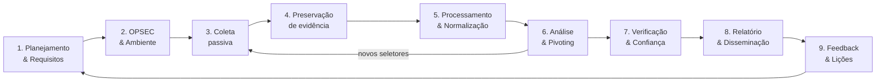

<div align="center">

# 🛰️ OSINT Ultimate Hub

**A base de conhecimento central para investigações em fontes abertas (Open Source Intelligence).**

Ferramentas · Fontes · Frameworks · APIs · Bibliotecas · Técnicas · Metodologias · OPSEC · Evidência · Treinamento


*Curadoria orientada a profissionais de OSINT, Threat Intelligence, Cybersecurity, Jornalismo Investigativo, Due Diligence e Digital Investigations.*

</div>

---

> [!CAUTION]
> ## ⚖️ Aviso de Uso Legal e Ético
>
> Este repositório é **exclusivamente educacional e profissional**. Os recursos listados devem ser usados **somente** em investigações **autorizadas, legítimas e proporcionais** — por exemplo: jornalismo, pesquisa acadêmica, defesa cibernética, threat intelligence, due diligence, compliance, apoio a autoridades, direitos humanos, localização de pessoas desaparecidas (ex.: Trace Labs) e testes de segurança com escopo contratado.
>
> - **É proibido** usar estes recursos para stalking, assédio, doxxing, discriminação, fraude, extorsão, vigilância ilegal, acesso não autorizado a sistemas ou qualquer violação de privacidade.
> - Respeite a legislação aplicável: **LGPD** (Brasil), **GDPR** (UE), **CCPA** (EUA/Califórnia), **Marco Civil da Internet**, **Lei 12.737/2012** (Carolina Dieckmann), **CFAA** (EUA), **Computer Misuse Act** (Reino Unido) e os **Termos de Serviço** de cada plataforma.
> - **Dados vazados** (breaches, stealer logs, combolists) podem ter restrições legais severas de posse e uso. Consulte seu jurídico antes de manipulá-los.
> - Coleta passiva ≠ interação. **Nunca** interaja, engane ou contate alvos sem autorização formal e base legal.
> - Os mantenedores **não se responsabilizam** pelo uso indevido. A inclusão de uma ferramenta **não é endosso**; verifique licenças, termos e segurança antes de usar.

---

## 📑 Índice

<details open>
<summary><b>Navegação rápida</b></summary>

| Fundamentos | Categorias — Pessoas & Social | Categorias — Infraestrutura | Categorias — Inteligência & Dados | Operação |
|---|---|---|---|---|
| [Overview](#-overview) | [Search Engines & Dorks](#-search-engines--dorks) | [Domains / DNS / WHOIS / RDAP](#-domains--dns--whois--rdap) | [Threat Intelligence](#-threat-intelligence) | [Self-hosted Stack](#-self-hosted-stack) |
| [Legenda](#-legenda) | [People Search](#-people-search) | [IP / ASN / BGP](#-ip--asn--bgp) | [Malware & IOC](#-malware--ioc-analysis) | [Automation & APIs](#-automation--apis) |
| [Top / Essential Tools](#-top--essential-tools) | [Usernames](#-usernames) | [Subdomains](#-subdomains) | [Breach & Exposure Research](#-breach--exposure-research) | [CLI Tools](#-cli-tools) |
| [Investigator Toolkit](#-investigator-toolkit) | [Email](#-email) | [Web Recon](#-web-recon) | [Company Intelligence](#-company-intelligence) | [Python / JS Libraries](#-python--js-libraries) |
| [Professional OSINT Stack](#-professional-osint-stack) | [Phone](#-phone) | [Archives](#-archives--web-history) | [Public Records](#-public-records) | [Browser Extensions](#-browser-extensions) |
| [OSINT Workflow](#-osint-workflow) | [SOCMINT](#-socmint--social-media-intelligence) | [URL Intelligence](#-url-intelligence) | [Brasil 🇧🇷](#-brasil--fontes-públicas) | [OPSEC](#-opsec) |
| [Quick Reference](#-quick-reference) | [GEOINT](#-geoint--geolocation--mapping) | [GitHub & Code](#-github--code-intelligence) | [Financial Intelligence](#-financial-intelligence--sanctions) | [Evidence & Documentation](#-evidence--documentation) |
| | [Transportes (Air/Sea)](#-transport-tracking--air-sea-rail-space) | [Cloud](#-cloud-osint) | [Crypto & Blockchain](#-crypto--blockchain) | [Reporting](#-reporting) |
| | [Image & Video](#-image--video-osint) | [Digital Forensics](#-digital-forensics) | [News & Fact Checking](#-news-fact-checking--disinformation) | [Learning Path](#-learning-path) |
| | [Metadata / EXIF](#-metadata--exif) | [Dark-Web Research](#-dark-web-research) | [Data Analysis](#-data-analysis) | [Training](#-training-ctfs--practice) |
| | | | [Graph Analysis](#-graph--link-analysis) | [Books](#-books) · [Papers](#-papers-standards--doctrine) |
| | | | [Automation & Scraping](#-automation--scraping) | [Cheat Sheets](#-cheat-sheets) · [Frameworks](#-osint-frameworks--directories) |
| | | | | [Resources](#-resources--communities) · [Contributing](#-contributing) |

</details>

---

## 🌐 Overview

**OSINT (Open Source Intelligence)** é a disciplina de coletar, processar, analisar e reportar informações obtidas de **fontes publicamente disponíveis** para responder a uma pergunta de inteligência específica. OSINT não é "achar coisas no Google": é um **processo analítico** com requisitos, metodologia, validação de fontes, documentação de evidências e comunicação de confiança.

Este hub foi desenhado como uma **knowledge base operacional**:

| Princípio | Como aplicamos |
|---|---|
| **Curadoria > volume** | Cada recurso tem finalidade, tipo, licença/custo e nível de uso. Duplicatas são removidas; cada ferramenta aparece em **uma** categoria principal. |
| **Fontes oficiais** | Links apontam para sites oficiais ou repositórios oficiais (GitHub/GitLab). |
| **Pivot-driven** | A [Quick Reference](#-quick-reference) mostra *de qual seletor para qual ferramenta* pivotar. |
| **Metodologia primeiro** | [Workflow](#-osint-workflow), [OPSEC](#-opsec) e [Evidence](#-evidence--documentation) são tratados como cidadãos de primeira classe. |
| **Ética e legalidade** | Recursos sensíveis são sinalizados com ⚠️. |

> [!NOTE]
> O ecossistema OSINT muda rápido: serviços são descontinuados, APIs fecham e ferramentas são arquivadas. Sempre **valide o status atual** de um recurso antes de depender dele em produção. Viu um link quebrado? Abra uma issue/PR — veja [Contributing](#-contributing).

---

## 🏷️ Legenda

| Campo | Valores |
|---|---|
| **Tipo** | `Web` serviço online · `CLI` linha de comando · `Lib` biblioteca · `API` interface programática · `Ext` extensão de navegador · `App` desktop/mobile · `Platform` plataforma completa · `Self-host` auto-hospedável · `Data` dataset/base · `OS` sistema operacional · `Docs` guia/documentação |
| **Acesso** | 🟢 **OSS** (código aberto) · 🆓 **Free** (gratuito, código fechado) · 💲 **Freemium** (plano gratuito limitado) · 💰 **Paid** (pago/enterprise) |
| **Nível** | 🟩 **Básico** · 🟨 **Intermediário** · 🟥 **Avançado** |
| **Marcadores** | ⭐ essencial · ⚠️ sensível (privacidade/legal/ética) · 🇧🇷 foco Brasil |

---

## ⭐ Top / Essential Tools

> O "kit mínimo" que praticamente todo investigador OSINT usa. Comece por aqui.

| # | Recurso | Finalidade | Tipo | Acesso | Nível |
|---|---|---|---|---|---|
| 1 | [Bellingcat Online Investigations Toolkit](https://bellingcat.gitbook.io/toolkit) | Diretório curado e comentado de ferramentas por categoria | Docs | 🆓 | 🟩 |
| 2 | [OSINT Framework](https://osintframework.com/) | Árvore interativa de recursos OSINT | Web | 🟢 | 🟩 |
| 3 | [Wayback Machine](https://web.archive.org/) | Histórico de páginas web e captura (*Save Page Now*) | Web/API | 🆓 | 🟩 |
| 4 | [CyberChef](https://gchq.github.io/CyberChef/) | "Canivete suíço" para decodificar, converter, extrair e analisar dados | Web | 🟢 | 🟩 |
| 5 | [ExifTool](https://exiftool.org/) | Leitura/escrita de metadados de praticamente qualquer arquivo | CLI | 🟢 | 🟨 |
| 6 | [InVID-WeVerify Plugin](https://www.invid-project.eu/tools-and-services/invid-verification-plugin/) | Verificação de vídeos/imagens: keyframes, busca reversa, forense | Ext | 🆓 | 🟩 |
| 7 | [Sherlock](https://github.com/sherlock-project/sherlock) / [Maigret](https://github.com/soxoj/maigret) | Enumeração de usernames em centenas de sites | CLI | 🟢 | 🟩 |
| 8 | [Holehe](https://github.com/megadose/holehe) | Verifica em quais sites um email está registrado | CLI | 🟢 | 🟩 |
| 9 | [crt.sh](https://crt.sh/) | Certificate Transparency: subdomínios e histórico de certificados | Web | 🆓 | 🟩 |
| 10 | [Shodan](https://www.shodan.io/) | Buscador de dispositivos/serviços expostos na Internet | Web/API | 💲 | 🟨 |
| 11 | [urlscan.io](https://urlscan.io/) | Sandbox de URLs: screenshot, requisições, DOM, IOCs | Web/API | 💲 | 🟩 |
| 12 | [VirusTotal](https://www.virustotal.com/) | Reputação de arquivos, URLs, domínios e IPs | Web/API | 💲 | 🟩 |
| 13 | [Have I Been Pwned](https://haveibeenpwned.com/) | Exposição de emails/domínios em vazamentos públicos | Web/API | 💲 | 🟩 |
| 14 | [OpenCorporates](https://opencorporates.com/) | Maior base aberta de empresas do mundo | Web/API | 💲 | 🟩 |
| 15 | [OCCRP Aleph](https://aleph.occrp.org/) | Busca em documentos, leaks e registros públicos para jornalismo | Web | 💲 | 🟨 |
| 16 | [Google Earth Pro](https://www.google.com/earth/about/versions/) | Imagens de satélite históricas, medição e camadas | App | 🆓 | 🟩 |
| 17 | [Overpass Turbo](https://overpass-turbo.eu/) | Consultas na base OpenStreetMap para geolocalização | Web | 🟢 | 🟥 |
| 18 | [SunCalc](https://www.suncalc.org/) | Posição do sol/sombras por local e horário (cronolocalização) | Web | 🆓 | 🟨 |
| 19 | [SpiderFoot](https://github.com/smicallef/spiderfoot) | Automação de reconhecimento com 200+ módulos | Self-host | 🟢 | 🟨 |
| 20 | [Maltego](https://www.maltego.com/) | Link analysis e pivoting visual com transforms | App | 💲 | 🟨 |
| 21 | [Hunchly](https://www.hunch.ly/) | Captura automática e forense de navegação investigativa | Ext | 💰 | 🟩 |
| 22 | [yt-dlp](https://github.com/yt-dlp/yt-dlp) | Download de vídeos/áudios de milhares de sites (preservação) | CLI | 🟢 | 🟩 |
| 23 | [OpenSanctions](https://www.opensanctions.org/) | Sanções, PEPs e entidades de interesse consolidadas | Web/API/Data | 💲 | 🟩 |
| 24 | [Tor Browser](https://www.torproject.org/) | Navegação anônima e acesso a serviços .onion | App | 🟢 | 🟩 |

---

## 🧰 Investigator Toolkit

> Kits por **perfil de investigação**. Cada kit referencia ferramentas detalhadas nas seções por categoria.

<details>
<summary><b>🔎 Pessoa / Identidade digital (due diligence, pessoas desaparecidas)</b></summary>

| Etapa | Ferramentas |
|---|---|
| Seletores iniciais | Nome, username, email, telefone, foto |
| Username → contas | Sherlock, Maigret, WhatsMyName, Blackbird |
| Email → contas/serviços | Holehe, GHunt, Epieos, Hunter |
| Telefone → titular/apps | PhoneInfoga, Ignorant, libphonenumber |
| Foto → outras ocorrências | Google Lens, Yandex, Bing Visual Search, TinEye |
| Registros | OpenCorporates, Public Records, registros judiciais |
| Preservação | Hunchly, SingleFile, Wayback "Save Page Now" |
</details>

<details>
<summary><b>🛡️ Threat Intelligence / CTI</b></summary>

| Etapa | Ferramentas |
|---|---|
| Triagem de IOC | VirusTotal, urlscan.io, AbuseIPDB, GreyNoise, ThreatFox |
| Infraestrutura | crt.sh, SecurityTrails, Shodan, Censys, Validin, bgp.he.net |
| Malware | MalwareBazaar, ANY.RUN, Triage, Hybrid Analysis, capa |
| Contexto de ator | MITRE ATT&CK, Malpedia, ransomware.live |
| Gestão | MISP, OpenCTI, IntelOwl |
</details>

<details>
<summary><b>📰 Jornalismo investigativo & verificação</b></summary>

| Etapa | Ferramentas |
|---|---|
| Verificação de mídia | InVID-WeVerify, Forensically, FotoForensics, ExifTool |
| Geolocalização | Google Earth Pro, Overpass Turbo, Bellingcat OSM Search, SunCalc, Mapillary |
| Contexto | Google Fact Check Explorer, GDELT, Wayback Machine |
| Documentos | Datashare, Google Pinpoint, DocumentCloud, Aleph |
| Publicação | Datawrapper, Flourish, TimelineJS |
</details>

<details>
<summary><b>🏢 Corporate / Financial / Due diligence</b></summary>

| Etapa | Ferramentas |
|---|---|
| Entidades | OpenCorporates, GLEIF, Companies House, SEC EDGAR, North Data |
| Beneficiário final & offshore | ICIJ Offshore Leaks, Aleph, LittleSis |
| Sanções & PEPs | OpenSanctions, OFAC, EU Sanctions Map, ONU |
| Contratos públicos | USAspending, TED (UE), PNCP 🇧🇷, Portal da Transparência 🇧🇷 |
| Cripto | Etherscan, Blockchair, Breadcrumbs, Arkham |
</details>

<details>
<summary><b>🌍 Attack Surface / External Recon (escopo autorizado)</b></summary>

| Etapa | Ferramentas |
|---|---|
| Domínios & certificados | crt.sh, Amass, Subfinder, dnsx |
| Hosts vivos & tech | httpx, Wappalyzer, WhatWeb, gowitness |
| Conteúdo histórico | gau, waybackurls, katana |
| Exposição | Shodan, Censys, LeakIX, GrayhatWarfare, trufflehog |
| Orquestração | BBOT, SpiderFoot, reNgine |
</details>

---

## 🏗️ Professional OSINT Stack

> Arquitetura de referência em camadas para equipes profissionais.

```text
┌──────────────────────────────────────────────────────────────────────────────┐
│  6. REPORTING        Obsidian/Markdown · Pandoc · Datawrapper · TimelineJS     │
│                      SysReptor · Ghostwriter · ICD 203 / Admiralty Code        │
├──────────────────────────────────────────────────────────────────────────────┤
│  5. ANALYSIS         Maltego · Gephi · Neo4j · OpenRefine · Jupyter/pandas     │
│                      QGIS · Kepler.gl · Timesketch · ACH (Heuer)                │
├──────────────────────────────────────────────────────────────────────────────┤
│  4. KNOWLEDGE MGMT   MISP · OpenCTI · Datashare · Aleph · Yeti · Obsidian      │
├──────────────────────────────────────────────────────────────────────────────┤
│  3. PROCESSING       CyberChef · ExifTool · Tesseract · Apache Tika · jq        │
├──────────────────────────────────────────────────────────────────────────────┤
│  2. COLLECTION       Search engines · SpiderFoot · BBOT · theHarvester         │
│                      APIs (Shodan, Censys, VT) · yt-dlp · Scrapy/Playwright     │
│  2b. PRESERVATION    Hunchly · SingleFile · ArchiveBox · Auto Archiver          │
├──────────────────────────────────────────────────────────────────────────────┤
│  1. OPSEC / INFRA    VM dedicada (Trace Labs VM/CSI Linux) · VPN · Tor · Kasm   │
│                      Containers de browser · Sock puppets · KeePassXC           │
└──────────────────────────────────────────────────────────────────────────────┘
```

| Camada | Open-source (custo zero) | Comercial (enterprise) |
|---|---|---|
| Ambiente | Trace Labs OSINT VM, Tails, Whonix, Kasm Workspaces CE | Authentic8 Silo, Hunchly |
| Coleta | SpiderFoot, BBOT, theHarvester, Recon-ng | Maltego Pro, Social Links, ShadowDragon |
| Infra intel | Amass, Subfinder, crt.sh | DomainTools, SecurityTrails, Validin, Silent Push |
| CTI | MISP, OpenCTI, IntelOwl | Recorded Future, Mandiant, Flashpoint |
| Documentos | Datashare, Aleph (instância OCCRP) | Nuix, Relativity |
| Grafos | Gephi, Neo4j Community | i2 Analyst's Notebook, Linkurious |
| Cripto | GraphSense, block explorers | Chainalysis, TRM Labs, Elliptic |

---

## 🔄 OSINT Workflow

> Baseado no **Ciclo de Inteligência** clássico, adaptado para OSINT e alinhado ao **Berkeley Protocol** (ONU/OHCHR).



| Fase | Pergunta-chave | Entregável | Boas práticas |
|---|---|---|---|
| **1. Planejamento** | *O que exatamente precisamos saber e por quê?* | Requisitos de inteligência (PIRs), escopo, base legal | Defina limites, prazos, seletores iniciais e critérios de parada |
| **2. OPSEC** | *Como não contaminar a investigação nem me expor?* | Ambiente isolado, personas, log de atividades | VM dedicada, VPN/Tor, browser limpo, contas de pesquisa |
| **3. Coleta** | *Onde a informação pode existir?* | Dados brutos + fonte + timestamp | Comece passivo; registre cada consulta e URL |
| **4. Preservação** | *Isso pode sumir amanhã?* | Capturas, WARC, hashes SHA-256 | Capture **antes** de analisar; hash imediato |
| **5. Processamento** | *Como tornar os dados utilizáveis?* | Datasets limpos, OCR, traduções, metadados | Normalize formatos; preserve o original |
| **6. Análise** | *O que os dados significam? Quais conexões existem?* | Grafos, timelines, mapas, hipóteses | Pivote seletor → seletor; use ACH contra viés |
| **7. Verificação** | *Quão confiável é isso?* | Avaliação de fonte/informação (Admiralty) | Corrobore com ≥2 fontes independentes |
| **8. Relatório** | *Como comunicar com clareza e incerteza?* | Relatório com BLUF, evidências e confiança | Linguagem de probabilidade estimativa |
| **9. Feedback** | *Respondemos o requisito?* | Lições aprendidas, novos requisitos | Atualize playbooks e ferramentas |

### 🧠 Avaliação de Fonte — Admiralty Code (NATO)

| Confiabilidade da fonte | | Credibilidade da informação | |
|---|---|---|---|
| **A** | Totalmente confiável | **1** | Confirmada por outras fontes |
| **B** | Normalmente confiável | **2** | Provavelmente verdadeira |
| **C** | Razoavelmente confiável | **3** | Possivelmente verdadeira |
| **D** | Normalmente não confiável | **4** | Duvidosa |
| **E** | Não confiável | **5** | Improvável |
| **F** | Confiabilidade não pode ser avaliada | **6** | Veracidade não pode ser avaliada |

### 📏 Linguagem de Probabilidade Estimativa (ICD 203)

| Termo | Probabilidade |
|---|---|
| Quase nenhuma chance / remota | 01–05% |
| Muito improvável | 05–20% |
| Improvável | 20–45% |
| Chances iguais | 45–55% |
| Provável | 55–80% |
| Muito provável | 80–95% |
| Quase certo | 95–99% |

---

## ⚡ Quick Reference

### 🔀 Matriz de Pivoting (seletor → onde pesquisar)

| Você tem… | Pivote para… | Ferramentas principais |
|---|---|---|
| **Username** | Contas em outras plataformas, posts, avatares | Sherlock, Maigret, WhatsMyName, Blackbird, buscadores com `"username"` |
| **Email** | Contas registradas, vazamentos, Google ID, domínio | Holehe, GHunt, Epieos, HIBP, Hunter, Intelligence X |
| **Telefone** | Operadora, país, apps (WhatsApp/Telegram), contas | libphonenumber, PhoneInfoga, Ignorant, Epieos |
| **Nome completo** | Registros, empresas, processos, redes sociais | People search, OpenCorporates, CourtListener, dorks |
| **Foto de pessoa/lugar** | Origem, outras ocorrências, local, data | Google Lens, Yandex, Bing, TinEye, ExifTool, SunCalc |
| **Domínio** | WHOIS/RDAP, DNS, subdomínios, histórico, tech | ICANN Lookup, crt.sh, SecurityTrails, Wayback, BuiltWith |
| **IP** | ASN, geolocalização, serviços, reputação | ipinfo, bgp.he.net, Shodan, Censys, AbuseIPDB, GreyNoise |
| **Hash de arquivo** | Detecções, família, sandbox, relações | VirusTotal, MalwareBazaar, Hybrid Analysis, Triage |
| **Carteira cripto** | Transações, clusters, labels, abuso | Blockchair, Etherscan, Arkham, Breadcrumbs, Chainabuse |
| **Empresa** | Sócios, filiais, sanções, contratos, leaks | OpenCorporates, GLEIF, OpenSanctions, Offshore Leaks |
| **Google Analytics / AdSense ID** | Outros sites do mesmo operador | BuiltWith, DNSlytics, urlscan.io (busca por string) |
| **Placa / embarcação / aeronave** | Rotas, registro, histórico | MarineTraffic, VesselFinder, ADS-B Exchange, Flightradar24 |

### 🔍 Google Dorks Essenciais

| Operador | Exemplo | Função |
|---|---|---|
| `site:` | `site:gov.br "relatório"` | Limita a um domínio/TLD |
| `filetype:` / `ext:` | `site:example.com filetype:pdf` | Tipo de arquivo |
| `intitle:` / `allintitle:` | `intitle:"index of" "backup"` | Termo no título |
| `inurl:` / `allinurl:` | `inurl:admin site:example.com` | Termo na URL |
| `intext:` | `intext:"@example.com"` | Termo no corpo |
| `"…"` | `"João da Silva" "engenheiro"` | Frase exata |
| `-` | `"acme" -site:acme.com` | Exclusão |
| `OR` / `\|` | `"ceo" (acme OR "acme inc")` | Alternativas |
| `*` | `"fundado em * por"` | Curinga |
| `before:` / `after:` | `"incidente" after:2024-01-01` | Filtro de data |
| `AROUND(n)` | `"acme" AROUND(5) "fraude"` | Proximidade (não documentado) |

```text
# Documentos expostos de uma organização
site:example.com (filetype:pdf OR filetype:docx OR filetype:xlsx OR filetype:pptx)

# Perfis de pessoas em redes profissionais
site:linkedin.com/in "Example Corp" ("analista" OR "engenheiro")

# Menções de um username fora da própria plataforma
"johndoe123" -site:instagram.com

# Diretórios abertos
intitle:"index of" "parent directory" site:example.com

# Pastes e códigos que citam um domínio
"example.com" (site:pastebin.com OR site:github.com OR site:gist.github.com)

# Subdomínios indexados (excluindo www)
site:*.example.com -www
```

> 📚 Mais dorks: [Google Hacking Database (Exploit-DB)](https://www.exploit-db.com/google-hacking-database) · [Operadores oficiais do Google](https://support.google.com/websearch/answer/2466433) · [Sintaxe DuckDuckGo](https://duckduckgo.com/duckduckgo-help-pages/results/syntax/)

### 💻 One-liners de CLI

```bash
# Usernames
sherlock johndoe --timeout 10
maigret johndoe --html

# Email
holehe target@example.com

# Subdomínios → hosts vivos → screenshots (somente escopo autorizado)
subfinder -d example.com -silent | dnsx -silent | httpx -silent -title -tech-detect -status-code
gowitness scan file -f hosts.txt

# Certificate Transparency via crt.sh
curl -s "https://crt.sh/?q=%25.example.com&output=json" | jq -r '.[].name_value' | sort -u

# URLs históricas (Wayback CDX)
curl -s "https://web.archive.org/cdx/search/cdx?url=example.com/*&output=txt&fl=original&collapse=urlkey" | sort -u

# WHOIS / RDAP / DNS
whois example.com
curl -s https://rdap.org/domain/example.com | jq .
dig +short ANY example.com ; dig +short TXT example.com ; dig -x 8.8.8.8 +short

# IP → ASN (Team Cymru)
whois -h whois.cymru.com " -v 8.8.8.8"

# Metadados
exiftool -a -u -g1 foto.jpg
exiftool -gpslatitude -gpslongitude -n foto.jpg

# Preservação de evidência
yt-dlp --write-info-json --write-thumbnail --write-description "URL"
sha256sum evidencia.* > hashes.sha256
```

---

# 📚 Ferramentas por Categoria

## 🔍 Search Engines & Dorks

**Buscadores gerais e alternativos** — cada índice é diferente; use vários.

| Recurso | Finalidade | Tipo | Acesso | Nível |
|---|---|---|---|---|
| [Google](https://www.google.com/) · [Advanced Search](https://www.google.com/advanced_search) | Maior índice; operadores avançados | Web | 🆓 | 🟩 |
| [Bing](https://www.bing.com/) | Índice próprio; operadores `ip:`, `language:`, `loc:` | Web | 🆓 | 🟩 |
| [Yandex](https://yandex.com/) | Excelente para Rússia/CEI e busca reversa de imagens | Web | 🆓 | 🟩 |
| [Baidu](https://www.baidu.com/) | Conteúdo chinês | Web | 🆓 | 🟨 |
| [Naver](https://www.naver.com/) | Conteúdo coreano | Web | 🆓 | 🟨 |
| [Seznam](https://www.seznam.cz/) | Conteúdo tcheco | Web | 🆓 | 🟨 |
| [DuckDuckGo](https://duckduckgo.com/) | Busca privada; *bangs* (`!g`, `!yandex`) | Web | 🆓 | 🟩 |
| [Brave Search](https://search.brave.com/) | Índice independente; API disponível | Web/API | 💲 | 🟩 |
| [Mojeek](https://www.mojeek.com/) | Índice independente e sem rastreamento | Web | 🆓 | 🟩 |
| [Startpage](https://www.startpage.com/) | Resultados do Google com privacidade | Web | 🆓 | 🟩 |
| [Kagi](https://kagi.com/) | Busca paga, sem anúncios, *lenses* customizáveis | Web | 💰 | 🟩 |
| [Marginalia Search](https://search.marginalia.nu/) | Web "pequena"/independente, blogs e sites antigos | Web | 🟢 | 🟩 |
| [Carrot2](https://search.carrot2.org/) | Clusterização de resultados por tema | Web | 🟢 | 🟨 |
| [SearXNG](https://github.com/searxng/searxng) | Metabuscador auto-hospedável | Self-host | 🟢 | 🟨 |

**Buscadores especializados**

| Recurso | Finalidade | Tipo | Acesso | Nível |
|---|---|---|---|---|
| [Google Scholar](https://scholar.google.com/) · [Semantic Scholar](https://www.semanticscholar.org/) · [BASE](https://www.base-search.net/) · [CORE](https://core.ac.uk/) | Literatura acadêmica | Web | 🆓 | 🟩 |
| [Internet Archive Scholar](https://scholar.archive.org/) | Artigos acadêmicos preservados | Web | 🆓 | 🟩 |
| [Google Dataset Search](https://datasetsearch.research.google.com/) | Descoberta de datasets | Web | 🆓 | 🟩 |
| [Google Books](https://books.google.com/) · [Google Patents](https://patents.google.com/) | Livros e patentes | Web | 🆓 | 🟩 |
| [Google Trends](https://trends.google.com/) | Interesse de busca ao longo do tempo/região | Web | 🆓 | 🟩 |
| [PublicWWW](https://publicwww.com/) | Busca no **código-fonte** de páginas (IDs de analytics, scripts) | Web | 💲 | 🟨 |
| [Wolfram Alpha](https://www.wolframalpha.com/) | Dados computáveis (geografia, astronomia, conversões) | Web | 💲 | 🟩 |
| [Google Hacking Database](https://www.exploit-db.com/google-hacking-database) | Catálogo de dorks categorizados | Docs | 🆓 | 🟨 |

> Busca de código (grep.app, Sourcegraph) → [GitHub & Code](#-github--code-intelligence). Buscadores de dispositivos (Shodan, Censys) → [IP / ASN / BGP](#-ip--asn--bgp).

---

## 👤 People Search

> ⚠️ **Alta sensibilidade.** Muitos serviços agregam dados pessoais; a legalidade varia por jurisdição (LGPD/GDPR). Use apenas com base legal e finalidade legítima. Vários serviços dos EUA só cobrem pessoas nos EUA.

| Recurso | Finalidade | Tipo | Acesso | Nível |
|---|---|---|---|---|
| [Epieos](https://epieos.com/) | Pivot por email/telefone → contas (Google, etc.) | Web | 💲 | 🟩 |
| [OSINT Industries](https://www.osint.industries/) | Lookup de email/telefone/username em centenas de módulos | Web/API | 💰 | 🟩 |
| [IDCrawl](https://www.idcrawl.com/) | Agregador de perfis públicos por nome/username | Web | 🆓 | 🟩 |
| [Webmii](https://webmii.com/) | Presença web de uma pessoa | Web | 🆓 | 🟩 |
| [PeekYou](https://www.peekyou.com/) | Perfis sociais por nome (EUA) | Web | 🆓 | 🟩 |
| [TruePeopleSearch](https://www.truepeoplesearch.com/) · [FastPeopleSearch](https://www.fastpeoplesearch.com/) | Endereços, parentes e telefones (EUA) ⚠️ | Web | 🆓 | 🟩 |
| [Whitepages](https://www.whitepages.com/) · [Spokeo](https://www.spokeo.com/) · [BeenVerified](https://www.beenverified.com/) | Background check comercial (EUA) ⚠️ | Web | 💰 | 🟩 |
| [Pipl](https://pipl.com/) | Identity resolution enterprise | API | 💰 | 🟨 |
| [192.com](https://www.192.com/) | Pessoas e empresas (Reino Unido) | Web | 💲 | 🟩 |
| [Canada411](https://www.canada411.ca/) | Listas telefônicas (Canadá) | Web | 🆓 | 🟩 |
| [FamilySearch](https://www.familysearch.org/) | Genealogia e registros civis históricos | Web | 🆓 | 🟩 |
| [Find a Grave](https://www.findagrave.com/) | Registros de sepultamento | Web | 🆓 | 🟩 |
| [Legacy.com](https://www.legacy.com/) | Obituários (mapeamento de relações familiares) | Web | 🆓 | 🟩 |

---

## 🆔 Usernames

| Recurso | Finalidade | Tipo | Acesso | Nível |
|---|---|---|---|---|
| ⭐ [Sherlock](https://github.com/sherlock-project/sherlock) | Verifica username em 400+ sites | CLI | 🟢 | 🟩 |
| ⭐ [Maigret](https://github.com/soxoj/maigret) | Evolução do Sherlock: milhares de sites, extração de perfil e relatórios | CLI | 🟢 | 🟩 |
| ⭐ [WhatsMyName](https://whatsmyname.app/) · [repo](https://github.com/WebBreacher/WhatsMyName) | Enumeração web com base de dados aberta mantida pela comunidade | Web/Data | 🟢 | 🟩 |
| [Blackbird](https://github.com/p1ngul1n0/blackbird) | Busca de username e email em 600+ sites | CLI | 🟢 | 🟩 |
| [Social Analyzer](https://github.com/qeeqbox/social-analyzer) | API/CLI/Web para análise de perfis em 1000+ sites | CLI/Web | 🟢 | 🟨 |
| [Namechk](https://namechk.com/) | Disponibilidade de username/domínio | Web | 🆓 | 🟩 |
| [Instant Username Search](https://instantusername.com/) | Checagem rápida em plataformas populares | Web | 🆓 | 🟩 |
| [GitFive](https://github.com/mxrch/GitFive) | OSINT de usuários GitHub (emails, contas vinculadas) | CLI | 🟢 | 🟨 |

> 💡 **Dica:** variações importam — `john.doe`, `john_doe`, `johndoe87`, `jdoe`. Teste também o username como *local-part* de email em provedores comuns.

---

## 📧 Email

| Recurso | Finalidade | Tipo | Acesso | Nível |
|---|---|---|---|---|
| ⭐ [Holehe](https://github.com/megadose/holehe) | Verifica cadastro do email em 120+ sites (via fluxo "esqueci a senha") | CLI | 🟢 | 🟩 |
| ⭐ [GHunt](https://github.com/mxrch/GHunt) | OSINT de contas Google (Gaia ID, reviews no Maps, serviços) | CLI | 🟢 | 🟨 |
| [Hunter](https://hunter.io/) | Emails corporativos, padrões de formato e verificação | Web/API/Ext | 💲 | 🟩 |
| [Phonebook.cz](https://phonebook.cz/) | Emails, domínios e URLs de um domínio (Intelligence X) | Web | 💲 | 🟩 |
| [EmailRep](https://emailrep.io/) | Reputação e presença de um email | API | 💲 | 🟩 |
| [Mosint](https://github.com/alpkeskin/mosint) | Framework OSINT para emails | CLI | 🟢 | 🟨 |
| [theHarvester](https://github.com/laramies/theHarvester) | Coleta de emails, nomes e subdomínios de fontes públicas | CLI | 🟢 | 🟩 |
| [Google Admin Toolbox — Messageheader](https://toolbox.googleapps.com/apps/messageheader/) | Análise de cabeçalhos de email (rota, SPF/DKIM) | Web | 🆓 | 🟨 |
| [MXToolbox](https://mxtoolbox.com/) | MX, SPF, DMARC, blacklists e header analyzer | Web | 💲 | 🟩 |
| [Gravatar](https://gravatar.com/) | Avatar/perfil público vinculado ao hash do email | Web/API | 🆓 | 🟨 |

> Vazamentos por email (HIBP, h8mail, DeHashed) → [Breach & Exposure Research](#-breach--exposure-research).

---

## 📱 Phone

| Recurso | Finalidade | Tipo | Acesso | Nível |
|---|---|---|---|---|
| [libphonenumber](https://github.com/google/libphonenumber) | Parsing, validação, país e tipo de linha | Lib | 🟢 | 🟨 |
| [PhoneInfoga](https://github.com/sundowndev/phoneinfoga) | Framework de OSINT para números (scanners + dorks) | CLI/Web | 🟢 | 🟨 |
| [Ignorant](https://github.com/megadose/ignorant) | Verifica se um número está vinculado a contas em alguns sites | CLI | 🟢 | 🟩 |
| [Truecaller](https://www.truecaller.com/) | Identificação de chamadas (crowdsourced) ⚠️ | App/Web | 💲 | 🟩 |
| [Sync.ME](https://sync.me/) | Caller ID / identificação de número | Web/App | 💲 | 🟩 |
| [NumVerify](https://numverify.com/) | API de validação e operadora | API | 💲 | 🟩 |
| [Free Carrier Lookup](https://freecarrierlookup.com/) | Operadora e tipo de linha | Web | 🆓 | 🟩 |

> 💡 **Técnica:** salvar o número em um dispositivo de pesquisa e checar WhatsApp/Telegram/Signal pode revelar foto e nome de perfil — **avalie as implicações legais e de OPSEC antes** (alguns apps notificam ou registram a consulta).

---

## 💬 SOCMINT — Social Media Intelligence

> ⚠️ Respeite os Termos de Serviço. Use contas de pesquisa (*sock puppets*) apenas onde for legal e autorizado pela sua organização. **Nunca interaja com alvos.**

**Multiplataforma & transparência de anúncios**

| Recurso | Finalidade | Tipo | Acesso | Nível |
|---|---|---|---|---|
| [Meta Ad Library](https://www.facebook.com/ads/library/) | Anúncios ativos/políticos no Facebook/Instagram | Web/API | 🆓 | 🟩 |
| [Google Ads Transparency Center](https://adstransparency.google.com/) | Anúncios por anunciante verificado | Web | 🆓 | 🟩 |
| [TikTok Ad Library](https://library.tiktok.com/) | Anúncios no TikTok (UE/DSA) | Web | 🆓 | 🟩 |
| [LinkedIn Ad Library](https://www.linkedin.com/ad-library/) | Anúncios no LinkedIn | Web | 🆓 | 🟩 |
| [gallery-dl](https://github.com/mikf/gallery-dl) | Download de mídia de dezenas de redes/galerias | CLI | 🟢 | 🟨 |

**Por plataforma**

| Plataforma | Recurso | Finalidade | Tipo | Acesso | Nível |
|---|---|---|---|---|---|
| X / Twitter | [X Advanced Search](https://x.com/search-advanced) | Busca com filtros (`from:`, `since:`, `until:`, `geocode:`) | Web | 🆓 | 🟩 |
| X / Twitter | [twscrape](https://github.com/vladkens/twscrape) | Coleta via API GraphQL (requer contas) | Lib | 🟢 | 🟥 |
| X / Twitter | [Treeverse](https://github.com/paulgb/Treeverse) | Visualização de árvores de conversas | Ext | 🟢 | 🟩 |
| Facebook | [Who Posted What?](https://whopostedwhat.com/) | Busca de posts por palavra-chave e data | Web | 🆓 | 🟨 |
| Instagram | [Instaloader](https://github.com/instaloader/instaloader) | Download de posts, stories e metadados | CLI/Lib | 🟢 | 🟨 |
| Instagram | [Toutatis](https://github.com/megadose/toutatis) | Extrai info de contas (email/telefone mascarados) | CLI | 🟢 | 🟨 |
| YouTube | [YouTube Metadata](https://mattw.io/youtube-metadata/) | Metadados completos e horário exato de upload | Web | 🟢 | 🟩 |
| YouTube | [YouTube Geofind](https://mattw.io/youtube-geofind/) | Busca de vídeos por localização/canal | Web | 🟢 | 🟩 |
| Reddit | [Arctic Shift](https://arctic-shift.photon-reddit.com/) | Arquivo e busca histórica do Reddit | Web/API | 🟢 | 🟨 |
| Reddit | [PullPush](https://pullpush.io/) | API de dados históricos do Reddit | API | 🆓 | 🟨 |
| Reddit | [PRAW](https://praw.readthedocs.io/) | Wrapper Python da API oficial | Lib | 🟢 | 🟨 |
| Telegram | [TGStat](https://tgstat.com/) | Busca e estatísticas de canais/grupos | Web | 💲 | 🟩 |
| Telegram | [Telemetr.io](https://telemetr.io/) | Analytics e busca de canais | Web | 💲 | 🟩 |
| Telegram | [Telethon](https://github.com/LonamiWebs/Telethon) | Cliente MTProto em Python para coleta | Lib | 🟢 | 🟥 |
| Telegram | [Telepathy](https://github.com/jordanwildon/Telepathy) | Arquivamento e análise de chats públicos | CLI | 🟢 | 🟨 |
| LinkedIn | [CrossLinked](https://github.com/m8sec/CrossLinked) | Enumeração de funcionários via buscadores + formato de email | CLI | 🟢 | 🟨 |
| Bluesky | [Bluesky Search](https://bsky.app/search) · [Clearsky](https://clearsky.app/) | Busca; listas e bloqueios públicos | Web | 🆓 | 🟩 |
| Bluesky | [AT Protocol SDK (Python)](https://atproto.blue/) | Coleta via API aberta/firehose | Lib | 🟢 | 🟥 |
| Fediverso | [Mastodon.py](https://github.com/halcy/Mastodon.py) · [Fediverse Observer](https://fediverse.observer/) | API e mapa de instâncias | Lib/Web | 🟢 | 🟨 |
| Snapchat | [Snap Map](https://map.snapchat.com/) | Stories públicas georreferenciadas | Web | 🆓 | 🟩 |
| Strava | [Global Heatmap](https://www.strava.com/maps/global-heatmap) | Padrões de atividade (bases, rotas) | Web | 💲 | 🟨 |
| Discord | [Disboard](https://disboard.org/) | Descoberta de servidores públicos | Web | 🆓 | 🟩 |
| TikTok | [TikTok Research API](https://developers.tiktok.com/products/research-api/) | Acesso acadêmico a dados públicos | API | 🆓 | 🟥 |

---

## 🗺️ GEOINT — Geolocation & Mapping

**Mapas, street-level e satélite**

| Recurso | Finalidade | Tipo | Acesso | Nível |
|---|---|---|---|---|
| ⭐ [Google Earth Pro](https://www.google.com/earth/about/versions/) | Imagens históricas, 3D, KML, medição | App | 🆓 | 🟩 |
| [Google Maps](https://www.google.com/maps) | Mapas e Street View | Web | 🆓 | 🟩 |
| [Bing Maps](https://www.bing.com/maps) | Vista aérea alternativa (datas diferentes) | Web | 🆓 | 🟩 |
| [Yandex Maps](https://yandex.com/maps/) | Panoramas fortes na Rússia/CEI | Web | 🆓 | 🟩 |
| [Baidu Maps](https://map.baidu.com/) | Mapas e street-level da China | Web | 🆓 | 🟨 |
| [Mapillary](https://www.mapillary.com/) | Imagens de rua crowdsourced (global) | Web/API | 🆓 | 🟩 |
| [KartaView](https://kartaview.org/) | Imagens de rua abertas | Web | 🟢 | 🟩 |
| [OpenStreetMap](https://www.openstreetmap.org/) | Mapa colaborativo com dados ricos | Web/Data | 🟢 | 🟩 |
| ⭐ [Overpass Turbo](https://overpass-turbo.eu/) | Consultas espaciais em OSM (ex.: "igreja a 200 m de ponte") | Web | 🟢 | 🟥 |
| ⭐ [Bellingcat OSM Search](https://osm-search.bellingcat.com/) | Combinações de feições em OSM sem escrever queries | Web | 🟢 | 🟨 |
| [Wikimapia](https://wikimapia.org/) | Mapa anotado colaborativamente | Web | 🆓 | 🟩 |
| [Copernicus Browser](https://browser.dataspace.copernicus.eu/) | Imagens Sentinel (UE), multiespectral, séries temporais | Web | 🆓 | 🟨 |
| [USGS EarthExplorer](https://earthexplorer.usgs.gov/) | Landsat e acervos históricos | Web | 🆓 | 🟨 |
| [NASA Worldview](https://worldview.earthdata.nasa.gov/) | Imagens diárias globais (MODIS/VIIRS) | Web | 🆓 | 🟩 |
| [NASA FIRMS](https://firms.modaps.eosdis.nasa.gov/) | Focos de incêndio/anomalias térmicas quase em tempo real | Web | 🆓 | 🟩 |
| [Google Earth Engine](https://earthengine.google.com/) | Análise geoespacial em larga escala | Platform | 💲 | 🟥 |
| [Planet](https://www.planet.com/) · [Maxar](https://www.maxar.com/) · [SkyFi](https://skyfi.com/) | Imagens comerciais de alta resolução | Platform | 💰 | 🟨 |
| [Zoom Earth](https://zoom.earth/) | Satélite quase em tempo real, clima | Web | 🆓 | 🟩 |
| [Satellites.pro](https://satellites.pro/) | Mosaico de vários provedores de imagem | Web | 🆓 | 🟩 |

**Geolocalização & cronolocalização**

| Recurso | Finalidade | Tipo | Acesso | Nível |
|---|---|---|---|---|
| ⭐ [SunCalc](https://www.suncalc.org/) | Azimute/elevação do sol, sombras | Web | 🆓 | 🟨 |
| [ShadowFinder](https://github.com/bellingcat/ShadowFinder) | Estima possíveis locais pelo comprimento de sombras | CLI/Lib | 🟢 | 🟥 |
| [PeakVisor](https://peakvisor.com/) · [PeakFinder](https://www.peakfinder.com/) | Identificação de montanhas/silhuetas no horizonte | Web/App | 💲 | 🟨 |
| [GeoHints](https://geohints.com/) · [Plonk It](https://www.plonkit.net/) | Pistas visuais por país (placas, postes, sinalização) | Docs | 🆓 | 🟩 |
| [GeoSpy](https://geospy.ai/) · [Picarta](https://picarta.ai/) | Geolocalização assistida por IA (**sempre valide**) | Web | 💲 | 🟩 |
| [GeoNames](https://www.geonames.org/) | Gazetteer global de topônimos | Web/API | 🟢 | 🟩 |
| [timeanddate](https://www.timeanddate.com/) | Fusos, nascer/pôr do sol, clima histórico | Web | 🆓 | 🟩 |
| [Weather Underground — History](https://www.wunderground.com/history) | Clima histórico para validar datas | Web | 🆓 | 🟩 |
| [Windy](https://www.windy.com/) | Clima, vento e webcams | Web | 🆓 | 🟩 |
| [QGIS](https://qgis.org/) | GIS desktop completo | App | 🟢 | 🟥 |

**Conflito, crise e eventos**

| Recurso | Finalidade | Tipo | Acesso | Nível |
|---|---|---|---|---|
| [ACLED](https://acleddata.com/) | Dados georreferenciados de conflitos e protestos | Data | 💲 | 🟨 |
| [Liveuamap](https://liveuamap.com/) | Mapa de eventos em tempo real | Web | 💲 | 🟩 |
| [DeepState Map](https://deepstatemap.live/) | Linha de frente na Ucrânia | Web | 🆓 | 🟩 |
| [USGS Earthquakes](https://earthquake.usgs.gov/earthquakes/map/) | Eventos sísmicos | Web/API | 🆓 | 🟩 |

---

## ✈️ Transport Tracking — Air, Sea, Rail, Space

| Recurso | Finalidade | Tipo | Acesso | Nível |
|---|---|---|---|---|
| [ADS-B Exchange](https://globe.adsbexchange.com/) | Rastreamento de voos com menos filtragem (inclui militares) | Web | 💲 | 🟩 |
| [adsb.lol](https://adsb.lol/) | Agregador ADS-B aberto, dados e API gratuitos | Web/API | 🟢 | 🟩 |
| [OpenSky Network](https://opensky-network.org/) | Dados ADS-B históricos para pesquisa | Web/API | 🆓 | 🟨 |
| [Flightradar24](https://www.flightradar24.com/) · [FlightAware](https://www.flightaware.com/) | Voos comerciais, histórico, registros | Web | 💲 | 🟩 |
| [MarineTraffic](https://www.marinetraffic.com/) · [VesselFinder](https://www.vesselfinder.com/) · [MyShipTracking](https://www.myshiptracking.com/) | Posição AIS de embarcações | Web | 💲 | 🟩 |
| [Global Fishing Watch](https://globalfishingwatch.org/map) | Atividade pesqueira, *dark vessels*, transbordos | Web/API | 🆓 | 🟨 |
| [Equasis](https://www.equasis.org/) | Registro, gestor e inspeções de navios | Web | 🆓 | 🟨 |
| [OpenRailwayMap](https://www.openrailwaymap.org/) | Infraestrutura ferroviária | Web | 🟢 | 🟩 |
| [CelesTrak](https://celestrak.org/) · [N2YO](https://www.n2yo.com/) | Órbitas de satélites (TLE) e passagens | Web | 🆓 | 🟨 |

---

## 🖼️ Image & Video OSINT

**Busca reversa de imagens** — use **todas**; os resultados diferem muito.

| Recurso | Finalidade | Tipo | Acesso | Nível |
|---|---|---|---|---|
| ⭐ [Google Lens](https://lens.google/) · [Google Images](https://images.google.com/) | Objetos, textos, locais, produtos | Web | 🆓 | 🟩 |
| ⭐ [Yandex Images](https://yandex.com/images/) | Muito forte para locais e imagens similares | Web | 🆓 | 🟩 |
| [Bing Visual Search](https://www.bing.com/visualsearch) | Busca visual alternativa | Web | 🆓 | 🟩 |
| [TinEye](https://tineye.com/) | Ocorrências exatas, ordenação pela mais antiga | Web/API | 💲 | 🟩 |
| [Baidu Images](https://image.baidu.com/) | Conteúdo asiático | Web | 🆓 | 🟨 |
| [PimEyes](https://pimeyes.com/) | Reconhecimento facial na web ⚠️ (uso altamente sensível) | Web | 💰 | 🟨 |
| [Search by Image](https://github.com/dessant/search-by-image) | Extensão: busca reversa em dezenas de motores | Ext | 🟢 | 🟩 |

**Forense e verificação**

| Recurso | Finalidade | Tipo | Acesso | Nível |
|---|---|---|---|---|
| ⭐ [InVID-WeVerify](https://www.invid-project.eu/tools-and-services/invid-verification-plugin/) | Keyframes, lupa, forense, metadados de vídeo | Ext | 🆓 | 🟩 |
| [Forensically](https://29a.ch/photo-forensics/) | ELA, clone detection, noise analysis | Web | 🆓 | 🟨 |
| [FotoForensics](https://fotoforensics.com/) | ELA e análise de metadados | Web | 💲 | 🟨 |
| [Hive AI-Generated Content Detection](https://hivemoderation.com/ai-generated-content-detection) | Detecção de conteúdo gerado por IA (indicativo, **não** prova) | Web | 💲 | 🟩 |
| [Watch Frame by Frame](https://www.watchframebyframe.com/) | Navegação quadro a quadro em YouTube/Vimeo | Web | 🆓 | 🟩 |
| [FFmpeg](https://ffmpeg.org/) | Extração de frames, conversão, metadados de stream | CLI | 🟢 | 🟨 |
| [Tesseract OCR](https://github.com/tesseract-ocr/tesseract) | OCR de texto em imagens (100+ idiomas) | CLI/Lib | 🟢 | 🟨 |
| [Upscayl](https://github.com/upscayl/upscayl) | Upscaling por IA (inventa detalhes — **não** use como evidência) | App | 🟢 | 🟩 |

```bash
# Extrair 1 frame por segundo de um vídeo para busca reversa
ffmpeg -i video.mp4 -vf fps=1 frames/frame_%04d.png
```

---

## 🏷️ Metadata & EXIF

| Recurso | Finalidade | Tipo | Acesso | Nível |
|---|---|---|---|---|
| ⭐ [ExifTool](https://exiftool.org/) | Padrão-ouro de leitura/escrita de metadados | CLI | 🟢 | 🟨 |
| [Exiv2](https://exiv2.org/) | Biblioteca/CLI de metadados de imagem | CLI/Lib | 🟢 | 🟨 |
| [MediaInfo](https://mediaarea.net/en/MediaInfo) | Metadados técnicos de áudio/vídeo | App/CLI | 🟢 | 🟩 |
| [FOCA](https://github.com/ElevenPaths/FOCA) | Extração de metadados de documentos publicados por um domínio | App | 🟢 | 🟨 |
| [oletools](https://github.com/decalage2/oletools) | Análise de documentos Office (macros, metadados) | CLI | 🟢 | 🟥 |
| [PDF Tools (Didier Stevens)](https://blog.didierstevens.com/programs/pdf-tools/) | `pdfid` / `pdf-parser`: estrutura e objetos de PDFs | CLI | 🟢 | 🟥 |
| [Hachoir](https://github.com/vstinner/hachoir) | Parser de arquivos binários e metadados | CLI/Lib | 🟢 | 🟥 |
| [mat2](https://0xacab.org/jvoisin/mat2) | **Remoção** de metadados (OPSEC ao compartilhar) | CLI | 🟢 | 🟩 |

> 💡 Redes sociais normalmente **removem** EXIF. Metadados originais costumam sobreviver em anexos de email, armazenamento em nuvem, fóruns, sites institucionais, PDFs e documentos Office.

---

## 🌐 Domains / DNS / WHOIS / RDAP

| Recurso | Finalidade | Tipo | Acesso | Nível |
|---|---|---|---|---|
| ⭐ [ICANN Lookup](https://lookup.icann.org/) | Registro oficial RDAP/WHOIS de gTLDs | Web | 🆓 | 🟩 |
| [rdap.org](https://rdap.org/) · [RDAP Web Client](https://client.rdap.org/) | Bootstrap RDAP (JSON) para domínios, IPs e ASNs | Web/API | 🟢 | 🟨 |
| [Registro.br WHOIS](https://registro.br/tecnologia/ferramentas/whois/) 🇧🇷 | WHOIS oficial de domínios `.br` | Web | 🆓 | 🟩 |
| [DomainTools](https://whois.domaintools.com/) | WHOIS atual + **histórico**, Iris (pivoting) | Web/API | 💰 | 🟨 |
| [WhoisXML API](https://www.whoisxmlapi.com/) | WHOIS histórico, reverse WHOIS, DNS | API | 💲 | 🟨 |
| [Whoxy](https://www.whoxy.com/) | WHOIS/reverse WHOIS barato via API | API | 💲 | 🟨 |
| [ViewDNS.info](https://viewdns.info/) | Reverse IP, reverse WHOIS, histórico de IP, 20+ utilitários | Web/API | 💲 | 🟩 |
| ⭐ [SecurityTrails](https://securitytrails.com/) | DNS histórico, subdomínios, reverse | Web/API | 💲 | 🟨 |
| [DNSDumpster](https://dnsdumpster.com/) | Mapa de DNS e hosts de um domínio | Web | 💲 | 🟩 |
| [Validin](https://www.validin.com/) | DNS histórico, pivots de infraestrutura (CTI) | Web/API | 💲 | 🟥 |
| [Silent Push](https://www.silentpush.com/) | Fingerprinting de infraestrutura e IOFA | Web/API | 💲 | 🟥 |
| [Robtex](https://www.robtex.com/) | Relações DNS/IP/ASN | Web | 💲 | 🟨 |
| [DNSlytics](https://dnslytics.com/) | Reverse por IP, NS, MX, Analytics/AdSense ID | Web | 💲 | 🟨 |
| [host.io](https://host.io/) | Backlinks, redirects, domínios co-hospedados | Web/API | 💲 | 🟩 |
| [DNSViz](https://dnsviz.net/) | Visualização/validação de DNSSEC | Web | 🟢 | 🟥 |
| [DNSChecker](https://dnschecker.org/) | Propagação DNS global | Web | 🆓 | 🟩 |
| [dnstwist](https://github.com/elceef/dnstwist) | Detecção de typosquatting/phishing de domínios | CLI | 🟢 | 🟨 |
| [Cert Spotter](https://sslmate.com/certspotter/) | Monitoramento de Certificate Transparency | Web/API | 💲 | 🟨 |

---

## 📡 IP / ASN / BGP

**Roteamento, alocação e geolocalização**

| Recurso | Finalidade | Tipo | Acesso | Nível |
|---|---|---|---|---|
| ⭐ [Hurricane Electric BGP Toolkit](https://bgp.he.net/) | ASN, prefixos, peers, IX | Web | 🆓 | 🟨 |
| [bgp.tools](https://bgp.tools/) | Visão BGP moderna, upstreams, prefixos | Web | 💲 | 🟨 |
| [RIPEstat](https://stat.ripe.net/) | Dados de roteamento, histórico, geoloc, RPKI | Web/API | 🆓 | 🟨 |
| [RIPE Atlas](https://atlas.ripe.net/) | Medições de rede globais (ping/traceroute) | Platform | 🆓 | 🟥 |
| [PeeringDB](https://www.peeringdb.com/) | Interconexão de redes e IXPs | Web/API | 🆓 | 🟨 |
| [Team Cymru IP to ASN](https://www.team-cymru.com/ip-asn-mapping) | Mapeamento IP→ASN em massa via whois/DNS | Service | 🆓 | 🟨 |
| [ARIN Search](https://search.arin.net/) · [RIPE DB](https://apps.db.ripe.net/db-web-ui/query) · [LACNIC](https://query.milacnic.lacnic.net/) | Registros regionais (RIRs) | Web | 🆓 | 🟨 |
| [IPinfo](https://ipinfo.io/) | Geolocalização, ASN, privacy detection | Web/API | 💲 | 🟩 |
| [MaxMind GeoLite](https://dev.maxmind.com/geoip/geolite2-free-geolocation-data) | Bases offline de geoloc/ASN | Data | 💲 | 🟨 |
| [IP2Location](https://www.ip2location.com/) | Geolocalização e proxy detection | Web/API/Data | 💲 | 🟩 |
| [Spur](https://spur.us/) | Detecção de VPN, proxies residenciais e anonimização | Web/API | 💲 | 🟨 |

**Buscadores de dispositivos/serviços expostos (Internet-wide scanning)**

| Recurso | Finalidade | Tipo | Acesso | Nível |
|---|---|---|---|---|
| ⭐ [Shodan](https://www.shodan.io/) | Banners, serviços, vulnerabilidades, ICS | Web/API | 💲 | 🟨 |
| ⭐ [Censys](https://search.censys.io/) | Hosts e certificados com busca estruturada | Web/API | 💲 | 🟨 |
| [FOFA](https://en.fofa.info/) | Buscador de ativos expostos (forte na Ásia) | Web/API | 💲 | 🟨 |
| [ZoomEye](https://www.zoomeye.ai/) | Buscador de ativos e serviços | Web/API | 💲 | 🟨 |
| [Netlas](https://netlas.io/) | Hosts, DNS, WHOIS, certificados | Web/API | 💲 | 🟨 |
| [Criminal IP](https://www.criminalip.io/) | Ativos expostos + score de risco | Web/API | 💲 | 🟨 |
| [ONYPHE](https://www.onyphe.io/) | Cyber defense search engine | Web/API | 💲 | 🟨 |
| [FullHunt](https://fullhunt.io/) | Attack surface de domínios | Web/API | 💲 | 🟨 |
| [Hunter.how](https://hunter.how/) | Buscador de ativos de Internet | Web/API | 💲 | 🟨 |
| [LeakIX](https://leakix.net/) | Serviços mal configurados e vazamentos expostos | Web/API | 💲 | 🟨 |

**Reputação**

| Recurso | Finalidade | Tipo | Acesso | Nível |
|---|---|---|---|---|
| ⭐ [AbuseIPDB](https://www.abuseipdb.com/) | Denúncias comunitárias de abuso por IP | Web/API | 💲 | 🟩 |
| ⭐ [GreyNoise](https://viz.greynoise.io/) | "Ruído" de Internet: scanners vs. ataques direcionados | Web/API | 💲 | 🟨 |
| [Spamhaus](https://check.spamhaus.org/) | Blocklists de IP/domínio | Web | 🆓 | 🟩 |
| [Shadowserver Dashboard](https://dashboard.shadowserver.org/) | Estatísticas globais de exposição e infecção | Web | 🆓 | 🟨 |

---

## 🧭 Subdomains

> Use apenas em escopos autorizados quando houver resolução ativa/bruteforce. Fontes passivas (CT, DNS histórico) são não intrusivas.

| Recurso | Finalidade | Tipo | Acesso | Nível |
|---|---|---|---|---|
| ⭐ [crt.sh](https://crt.sh/) | Certificate Transparency (inclui saída JSON) | Web | 🆓 | 🟩 |
| ⭐ [Subfinder](https://github.com/projectdiscovery/subfinder) | Enumeração passiva rápida com dezenas de fontes | CLI | 🟢 | 🟨 |
| ⭐ [OWASP Amass](https://github.com/owasp-amass/amass) | Mapeamento profundo de superfície de ataque | CLI | 🟢 | 🟥 |
| [assetfinder](https://github.com/tomnomnom/assetfinder) | Descoberta simples de domínios relacionados | CLI | 🟢 | 🟩 |
| [Findomain](https://github.com/Findomain/Findomain) | Enumerador rápido multi-fonte | CLI | 🟢 | 🟨 |
| [Sublist3r](https://github.com/aboul3la/Sublist3r) | Enumerador clássico via buscadores | CLI | 🟢 | 🟩 |
| [dnsx](https://github.com/projectdiscovery/dnsx) | Resolução DNS em massa e filtragem | CLI | 🟢 | 🟨 |
| [puredns](https://github.com/d3mondev/puredns) | Bruteforce/resolução com filtro de wildcards | CLI | 🟢 | 🟥 |
| [massdns](https://github.com/blechschmidt/massdns) | Resolver DNS de altíssimo desempenho | CLI | 🟢 | 🟥 |
| [alterx](https://github.com/projectdiscovery/alterx) | Geração de permutações de subdomínios | CLI | 🟢 | 🟥 |
| [Chaos](https://chaos.projectdiscovery.io/) | Dataset público de subdomínios de programas de bug bounty | Data/API | 🆓 | 🟨 |

---

## 🕸️ Web Recon

| Recurso | Finalidade | Tipo | Acesso | Nível |
|---|---|---|---|---|
| ⭐ [Web-Check](https://web-check.xyz/) · [repo](https://github.com/Lissy93/web-check) | Raio-X de um site: DNS, TLS, headers, tech, trackers | Web/Self-host | 🟢 | 🟩 |
| ⭐ [httpx](https://github.com/projectdiscovery/httpx) | Probe HTTP: status, título, tech, CDN | CLI | 🟢 | 🟨 |
| [BuiltWith](https://builtwith.com/) | Tecnologias + **relationship profiles** (IDs compartilhados) | Web/API | 💲 | 🟩 |
| [Wappalyzer](https://www.wappalyzer.com/) | Identificação de tecnologias | Ext/API | 💲 | 🟩 |
| [WhatWeb](https://github.com/urbanadventurer/WhatWeb) | Fingerprinting de tecnologias web | CLI | 🟢 | 🟨 |
| [katana](https://github.com/projectdiscovery/katana) | Crawler moderno (headless/JS) | CLI | 🟢 | 🟨 |
| [hakrawler](https://github.com/hakluke/hakrawler) | Crawler rápido de URLs/JS | CLI | 🟢 | 🟨 |
| [gau](https://github.com/lc/gau) | URLs conhecidas de Wayback, Common Crawl, OTX, URLScan | CLI | 🟢 | 🟨 |
| [waybackurls](https://github.com/tomnomnom/waybackurls) | URLs históricas da Wayback Machine | CLI | 🟢 | 🟩 |
| [ParamSpider](https://github.com/devanshbatham/ParamSpider) | Parâmetros de URLs a partir de arquivos web | CLI | 🟢 | 🟨 |
| [LinkFinder](https://github.com/GerbenJavado/LinkFinder) | Endpoints em arquivos JavaScript | CLI | 🟢 | 🟨 |
| [gowitness](https://github.com/sensepost/gowitness) | Screenshots em massa de sites | CLI | 🟢 | 🟨 |
| [EyeWitness](https://github.com/RedSiege/EyeWitness) | Screenshots + relatório de serviços web | CLI | 🟢 | 🟨 |
| [wafw00f](https://github.com/EnableSecurity/wafw00f) | Identificação de WAF | CLI | 🟢 | 🟨 |
| [Qualys SSL Labs](https://www.ssllabs.com/ssltest/) · [testssl.sh](https://testssl.sh/) | Configuração TLS e certificados | Web/CLI | 🟢 | 🟨 |
| [Photon](https://github.com/s0md3v/Photon) | Crawler OSINT (emails, URLs, arquivos, secrets) | CLI | 🟢 | 🟨 |

---

## 🗄️ Archives & Web History

| Recurso | Finalidade | Tipo | Acesso | Nível |
|---|---|---|---|---|
| ⭐ [Wayback Machine](https://web.archive.org/) | Arquivo da web desde 1996; *Save Page Now* | Web/API | 🆓 | 🟩 |
| ⭐ [archive.today](https://archive.ph/) | Snapshots sob demanda (inclui páginas dinâmicas) | Web | 🆓 | 🟩 |
| [Common Crawl](https://commoncrawl.org/) | Petabytes de crawl aberto (WARC) + índice CDX | Data | 🟢 | 🟥 |
| [Arquivo.pt](https://arquivo.pt/) | Arquivo web português (forte em conteúdo lusófono) | Web/API | 🆓 | 🟩 |
| [UK Web Archive](https://www.webarchive.org.uk/) | Arquivo web britânico | Web | 🆓 | 🟩 |
| [CachedView](https://cachedview.nl/) | Atalho para caches/arquivos | Web | 🆓 | 🟩 |
| [OldWeb.today](https://oldweb.today/) | Navegar arquivos em navegadores antigos emulados | Web | 🟢 | 🟩 |
| [Wayback CDX Server API](https://github.com/internetarchive/wayback/tree/master/wayback-cdx-server) | Listagem programática de capturas | API | 🆓 | 🟨 |
| [waybackpack](https://github.com/jsvine/waybackpack) | Baixa todas as versões arquivadas de uma URL | CLI | 🟢 | 🟨 |

> Ferramentas de **captura** (SingleFile, ArchiveBox, Webrecorder) → [Evidence & Documentation](#-evidence--documentation).

---

## 🔗 URL Intelligence

| Recurso | Finalidade | Tipo | Acesso | Nível |
|---|---|---|---|---|
| ⭐ [urlscan.io](https://urlscan.io/) | Sandbox: screenshot, DOM, requests, tecnologias; busca histórica | Web/API | 💲 | 🟩 |
| ⭐ [VirusTotal](https://www.virustotal.com/) | Reputação de URL/domínio + relações | Web/API | 💲 | 🟩 |
| [URLVoid](https://www.urlvoid.com/) | Reputação de site em múltiplas blocklists | Web | 🆓 | 🟩 |
| [Google Safe Browsing Status](https://transparencyreport.google.com/safe-browsing/search) | Status de site no Safe Browsing | Web | 🆓 | 🟩 |
| [URLhaus](https://urlhaus.abuse.ch/) | URLs de distribuição de malware | Web/API | 🆓 | 🟩 |
| [PhishTank](https://phishtank.org/) · [OpenPhish](https://openphish.com/) | Feeds de phishing | Web/Feed | 🆓 | 🟩 |
| [CheckPhish](https://checkphish.bolster.ai/) | Detecção de phishing/scam por IA | Web | 💲 | 🟩 |
| [WhereGoes](https://wheregoes.com/) · [CheckShortURL](https://checkshorturl.com/) | Seguir redirects e expandir URLs encurtadas | Web | 🆓 | 🟩 |

> 💡 Encurtadores: adicionar `+` ao final de um link `bit.ly` mostra as estatísticas/destino sem visitar.

---

## 💻 GitHub & Code Intelligence

| Recurso | Finalidade | Tipo | Acesso | Nível |
|---|---|---|---|---|
| ⭐ [GitHub Code Search](https://github.com/search?type=code) | Busca de código com regex e qualificadores | Web | 🆓 | 🟩 |
| ⭐ [grep.app](https://grep.app/) | Busca rápida em ~1M de repositórios | Web | 🆓 | 🟩 |
| [Sourcegraph](https://sourcegraph.com/search) | Busca de código em larga escala | Web | 💲 | 🟨 |
| [searchcode](https://searchcode.com/) | Busca de código multi-fonte | Web | 🆓 | 🟩 |
| ⭐ [TruffleHog](https://github.com/trufflesecurity/trufflehog) | Detecção e **verificação** de segredos em repos/histórico | CLI | 🟢 | 🟨 |
| [Gitleaks](https://github.com/gitleaks/gitleaks) | Detecção de segredos em git | CLI | 🟢 | 🟨 |
| [Libraries.io](https://libraries.io/) | Pacotes e dependências de 30+ ecossistemas | Web/API | 🟢 | 🟨 |
| [Postman Public API Network](https://www.postman.com/explore) | Coleções públicas (às vezes expõem endpoints/chaves) ⚠️ | Web | 🆓 | 🟨 |

> Perfis de usuários GitHub (GitFive) → [Usernames](#-usernames).

> 💡 **Técnica:** commits carregam `author.email`. Adicione `.patch` ao final de uma URL de commit do GitHub para ver o email do autor.

---

## ☁️ Cloud OSINT

| Recurso | Finalidade | Tipo | Acesso | Nível |
|---|---|---|---|---|
| ⭐ [GrayhatWarfare](https://buckets.grayhatwarfare.com/) | Busca em buckets S3/Azure/GCP abertos ⚠️ | Web | 💲 | 🟨 |
| [cloud_enum](https://github.com/initstring/cloud_enum) | Enumeração de recursos públicos em AWS/Azure/GCP | CLI | 🟢 | 🟨 |
| [S3Scanner](https://github.com/sa7mon/S3Scanner) | Buckets abertos em S3 e compatíveis | CLI | 🟢 | 🟨 |
| [AADInternals](https://github.com/Gerenios/AADInternals) | Recon de tenants Entra ID/Azure AD (módulo PowerShell) | CLI | 🟢 | 🟥 |
| [ROADtools](https://github.com/dirkjanm/ROADtools) | Exploração de Entra ID (com credenciais autorizadas) | CLI | 🟢 | 🟥 |
| [MicroBurst](https://github.com/NetSPI/MicroBurst) | Avaliação de segurança de Azure | CLI | 🟢 | 🟥 |
| [AWS IP Ranges](https://ip-ranges.amazonaws.com/ip-ranges.json) | Faixas oficiais de IP da AWS (atribuir IP→cloud) | Data | 🆓 | 🟨 |

---

## 🧪 Digital Forensics

| Recurso | Finalidade | Tipo | Acesso | Nível |
|---|---|---|---|---|
| ⭐ [Autopsy](https://www.autopsy.com/) / [The Sleuth Kit](https://www.sleuthkit.org/) | Forense de disco com interface gráfica | App | 🟢 | 🟨 |
| [Volatility 3](https://github.com/volatilityfoundation/volatility3) | Forense de memória RAM | CLI | 🟢 | 🟥 |
| [Plaso (log2timeline)](https://github.com/log2timeline/plaso) | Super-timelines a partir de artefatos | CLI | 🟢 | 🟥 |
| [Timesketch](https://github.com/google/timesketch) | Análise colaborativa de timelines | Self-host | 🟢 | 🟥 |
| [Velociraptor](https://github.com/Velocidex/velociraptor) | DFIR e coleta de artefatos em endpoints | Self-host | 🟢 | 🟥 |
| [Eric Zimmerman's Tools](https://ericzimmerman.github.io/) | Parsers de artefatos Windows (MFT, Registry, LNK…) | CLI/App | 🆓 | 🟥 |
| [FTK Imager](https://www.exterro.com/digital-forensics-software/ftk-imager) | Aquisição e preview de imagens forenses | App | 🆓 | 🟨 |
| [bulk_extractor](https://github.com/simsong/bulk_extractor) | Extração de emails, URLs, cartões etc. de imagens de disco | CLI | 🟢 | 🟥 |
| [PhotoRec / TestDisk](https://www.cgsecurity.org/) | Recuperação de arquivos/partições | CLI | 🟢 | 🟨 |
| [Wireshark](https://www.wireshark.org/) · [NetworkMiner](https://www.netresec.com/?page=NetworkMiner) | Análise de tráfego / forense de rede | App | 🟢 | 🟨 |
| [MVT — Mobile Verification Toolkit](https://github.com/mvt-project/mvt) | Detecção de spyware (ex.: Pegasus) em iOS/Android | CLI | 🟢 | 🟥 |
| [iLEAPP](https://github.com/abrignoni/iLEAPP) · [ALEAPP](https://github.com/abrignoni/ALEAPP) | Parsers de artefatos iOS/Android | CLI | 🟢 | 🟥 |
| [binwalk](https://github.com/ReFirmLabs/binwalk) | Análise e extração de firmware/binários | CLI | 🟢 | 🟥 |
| [SIFT Workstation](https://www.sans.org/tools/sift-workstation/) · [Tsurugi Linux](https://tsurugi-linux.org/) · [CAINE](https://www.caine-live.net/) | Distribuições forenses | OS | 🟢 | 🟨 |

---

## 🕳️ Dark-Web Research

> ⚠️ **Alto risco.** Use ambientes isolados (VM descartável, Tails/Whonix), nunca baixe/execute arquivos, não compre/interaja e esteja ciente de que **acessar certos conteúdos é crime** (ex.: CSAM — reporte imediatamente às autoridades/[SaferNet](https://new.safernet.org.br/denuncie) 🇧🇷 / [NCMEC](https://report.cybertip.org/)).

| Recurso | Finalidade | Tipo | Acesso | Nível |
|---|---|---|---|---|
| ⭐ [Tor Browser](https://www.torproject.org/) | Acesso a serviços .onion | App | 🟢 | 🟩 |
| [Ahmia](https://ahmia.fi/) | Buscador de serviços onion (filtra conteúdo abusivo) | Web | 🟢 | 🟩 |
| [OnionSearch](https://github.com/megadose/OnionSearch) | Busca agregada em múltiplos buscadores onion | CLI | 🟢 | 🟨 |
| [TorBot](https://github.com/DedSecInside/TorBot) | Crawler OSINT para .onion | CLI | 🟢 | 🟥 |
| ⭐ [ransomware.live](https://www.ransomware.live/) | Monitoramento de leak sites de ransomware | Web/API | 🆓 | 🟩 |
| [RansomLook](https://www.ransomlook.io/) | Tracker aberto de grupos de ransomware e fóruns | Web | 🟢 | 🟩 |
| [Intelligence X](https://intelx.io/) | Índice de darknet, leaks, pastes e histórico | Web/API | 💲 | 🟨 |
| [DarkOwl](https://www.darkowl.com/) · [Flashpoint](https://flashpoint.io/) · [Recorded Future](https://www.recordedfuture.com/) | Inteligência comercial de darknet/fóruns | Platform | 💰 | 🟨 |

---

## 🛡️ Threat Intelligence

**Plataformas, frameworks e conhecimento**

| Recurso | Finalidade | Tipo | Acesso | Nível |
|---|---|---|---|---|
| ⭐ [MITRE ATT&CK](https://attack.mitre.org/) | Base de táticas e técnicas adversárias | Docs | 🆓 | 🟨 |
| [MITRE D3FEND](https://d3fend.mitre.org/) | Base de contramedidas defensivas | Docs | 🆓 | 🟥 |
| ⭐ [MISP](https://www.misp-project.org/) | Plataforma de compartilhamento de IOCs/inteligência | Self-host | 🟢 | 🟥 |
| ⭐ [OpenCTI](https://github.com/OpenCTI-Platform/opencti) | Plataforma de CTI baseada em STIX 2.1 | Self-host | 🟢 | 🟥 |
| [IntelOwl](https://github.com/intelowlproject/IntelOwl) | Enriquecimento de observáveis com 100+ analisadores | Self-host | 🟢 | 🟨 |
| [Yeti](https://github.com/yeti-platform/yeti) | Repositório de observáveis, TTPs e indicadores | Self-host | 🟢 | 🟥 |
| [TheHive](https://strangebee.com/thehive/) | Gestão de casos de resposta a incidentes | Self-host | 💲 | 🟥 |
| [AlienVault OTX](https://otx.alienvault.com/) | Pulses de IOCs da comunidade | Web/API | 🆓 | 🟩 |
| [Pulsedive](https://pulsedive.com/) | Enriquecimento e feeds de IOCs | Web/API | 💲 | 🟩 |
| [CISA KEV Catalog](https://www.cisa.gov/known-exploited-vulnerabilities-catalog) | Vulnerabilidades exploradas ativamente | Data | 🆓 | 🟩 |
| [NVD](https://nvd.nist.gov/) · [CVE.org](https://www.cve.org/) | Bases oficiais de vulnerabilidades | Web/API | 🆓 | 🟩 |
| [CIRCL Services](https://www.circl.lu/services/) | Passive DNS, Passive SSL, hashlookup e mais | API | 🆓 | 🟨 |
| [Malpedia](https://malpedia.caad.fkie.fraunhofer.de/) | Famílias de malware, atores e referências | Web | 🆓 | 🟨 |
| [ETDA Threat Group Cards](https://apt.etda.or.th/cgi-bin/aptgroups.cgi) | Enciclopédia de grupos APT e aliases | Web | 🆓 | 🟨 |
| [ICHI — Internet Cyber Health Index](https://ichi.global) | Barômetro diário da saúde cibernética da internet; agrega notícias de segurança, telemetria e alertas de múltiplas fontes com transparência de origem | Web | 🆓 | 🟩 |

---

## 🦠 Malware & IOC Analysis

| Recurso | Finalidade | Tipo | Acesso | Nível |
|---|---|---|---|---|
| ⭐ [MalwareBazaar](https://bazaar.abuse.ch/) | Repositório de amostras de malware | Web/API | 🆓 | 🟨 |
| ⭐ [ThreatFox](https://threatfox.abuse.ch/) | IOCs de malware compartilhados | Web/API | 🆓 | 🟩 |
| [Feodo Tracker](https://feodotracker.abuse.ch/) | Infraestrutura C2 de botnets | Web/Feed | 🆓 | 🟩 |
| ⭐ [ANY.RUN](https://any.run/) | Sandbox interativa | Web | 💲 | 🟨 |
| [Triage](https://tria.ge/) | Sandbox automatizada com extração de configs | Web/API | 💲 | 🟨 |
| [Hybrid Analysis](https://www.hybrid-analysis.com/) | Sandbox gratuita (CrowdStrike Falcon) | Web/API | 🆓 | 🟨 |
| [Joe Sandbox](https://www.joesandbox.com/) | Sandbox profunda multiplataforma | Web | 💲 | 🟨 |
| [FileScan.IO](https://www.filescan.io/) | Análise estática/emulação rápida | Web | 💲 | 🟨 |
| [UnpacMe](https://www.unpac.me/) | Unpacking automatizado | Web | 💲 | 🟥 |
| [CAPE Sandbox](https://github.com/kevoreilly/CAPEv2) | Sandbox self-hosted com extração de configs | Self-host | 🟢 | 🟥 |
| [capa](https://github.com/mandiant/capa) | Identifica capacidades de executáveis | CLI | 🟢 | 🟥 |
| [FLOSS](https://github.com/mandiant/flare-floss) | Extração de strings ofuscadas | CLI | 🟢 | 🟥 |
| [Detect It Easy](https://github.com/horsicq/Detect-It-Easy) | Identificação de packer/compilador | App | 🟢 | 🟨 |
| [YARA](https://github.com/VirusTotal/yara) · [YARA-X](https://github.com/VirusTotal/yara-x) | Regras de identificação de malware | CLI | 🟢 | 🟥 |
| [Sigma](https://github.com/SigmaHQ/sigma) | Regras genéricas de detecção em logs | Docs | 🟢 | 🟥 |
| [Ghidra](https://ghidra-sre.org/) | Engenharia reversa (NSA) | App | 🟢 | 🟥 |
| [REMnux](https://remnux.org/) | Distro Linux para análise de malware | OS | 🟢 | 🟥 |
| [ID Ransomware](https://id-ransomware.malwarehunterteam.com/) | Identifica a família de ransomware | Web | 🆓 | 🟩 |
| [No More Ransom](https://www.nomoreransom.org/) | Decryptors oficiais (Europol + parceiros) | Web | 🆓 | 🟩 |
| [vx-underground](https://vx-underground.org/) | Biblioteca de amostras e papers de malware | Web | 🆓 | 🟥 |

---

## 💧 Breach & Exposure Research

> ⚠️ **Atenção jurídica.** Consultar se um seletor foi exposto (HIBP) é diferente de **obter/possuir** dados vazados. Posse, compra ou redistribuição de bases vazadas pode ser crime e viola LGPD/GDPR. Use somente serviços legítimos e com finalidade defensiva/autorizada.

| Recurso | Finalidade | Tipo | Acesso | Nível |
|---|---|---|---|---|
| ⭐ [Have I Been Pwned](https://haveibeenpwned.com/) | Exposição de email/domínio em breaches; Pwned Passwords | Web/API | 💲 | 🟩 |
| [Mozilla Monitor](https://monitor.mozilla.org/) | Alertas de exposição de email | Web | 💲 | 🟩 |
| [Hudson Rock — Free Tools](https://www.hudsonrock.com/free-tools) | Verifica exposição em infostealers (email/domínio) | Web/API | 💲 | 🟩 |
| [DeHashed](https://dehashed.com/) | Busca em dados de breach por múltiplos campos | Web/API | 💰 | 🟨 |
| [LeakCheck](https://leakcheck.io/) | Busca de exposição por email/username/domínio | Web/API | 💲 | 🟨 |
| [h8mail](https://github.com/khast3x/h8mail) | Caça de emails em breaches via APIs | CLI | 🟢 | 🟨 |

> Também relevantes: [Intelligence X](#-dark-web-research) (leaks/pastes) · [LeakIX](#-ip--asn--bgp) (serviços mal configurados) · [GrayhatWarfare](#-cloud-osint) (buckets abertos).

---

## 🏢 Company Intelligence

| Recurso | Finalidade | Tipo | Acesso | Nível |
|---|---|---|---|---|
| ⭐ [OpenCorporates](https://opencorporates.com/) | 200M+ empresas de 140+ jurisdições | Web/API | 💲 | 🟩 |
| ⭐ [GLEIF LEI Search](https://search.gleif.org/) | Identificadores LEI e relações de controle (parent/child) | Web/API | 🆓 | 🟩 |
| [OCCRP Aleph](https://aleph.occrp.org/) | Registros, leaks e documentos para investigação | Web | 💲 | 🟨 |
| [ICIJ Offshore Leaks](https://offshoreleaks.icij.org/) | Panama/Paradise/Pandora Papers e outros | Web/Data | 🆓 | 🟩 |
| [SEC EDGAR](https://www.sec.gov/edgar/search/) | Filings de empresas listadas nos EUA (full-text search) | Web/API | 🆓 | 🟩 |
| [UK Companies House](https://find-and-update.company-information.service.gov.uk/) | Empresas, diretores e PSC (Reino Unido) | Web/API | 🆓 | 🟩 |
| [North Data](https://www.northdata.com/) | Empresas europeias, redes de pessoas, financeiros | Web | 💲 | 🟩 |
| [LittleSis](https://littlesis.org/) | Mapa de poder: conexões entre elites e organizações | Web | 🟢 | 🟩 |
| [Wikidata](https://www.wikidata.org/) · [Query Service](https://query.wikidata.org/) | Dados estruturados (SPARQL) sobre entidades | Web/API | 🟢 | 🟥 |
| [Crunchbase](https://www.crunchbase.com/) | Startups, investimentos e executivos | Web | 💲 | 🟩 |
| [ImportYeti](https://www.importyeti.com/) | Registros de importação marítima dos EUA (fornecedores) | Web | 💲 | 🟨 |
| [ProPublica Nonprofit Explorer](https://projects.propublica.org/nonprofits/) | Declarações fiscais de ONGs dos EUA (Form 990) | Web/API | 🆓 | 🟩 |
| [WIPO Global Brand Database](https://branddb.wipo.int/) · [PATENTSCOPE](https://patentscope.wipo.int/) | Marcas e patentes internacionais | Web | 🆓 | 🟩 |
| [Espacenet](https://worldwide.espacenet.com/) | Patentes (EPO) | Web | 🆓 | 🟩 |
| [Orbis (Moody's/BvD)](https://www.moodys.com/web/en/us/capabilities/company-reference-data/orbis.html) | Base global de empresas e beneficiários | Platform | 💰 | 🟨 |

---

## 📜 Public Records

| Recurso | Finalidade | Tipo | Acesso | Nível |
|---|---|---|---|---|
| [CourtListener / RECAP](https://www.courtlistener.com/) | Processos e decisões judiciais dos EUA (incl. PACER) | Web/API | 🟢 | 🟩 |
| [PACER](https://pacer.uscourts.gov/) | Sistema oficial de processos federais dos EUA | Web | 💰 | 🟨 |
| [Judyrecords](https://www.judyrecords.com/) | Busca em centenas de milhões de processos dos EUA | Web | 🆓 | 🟩 |
| [NETR Online](https://publicrecords.netronline.com/) | Diretório de registros imobiliários dos EUA | Web | 🆓 | 🟩 |
| [BAILII](https://www.bailii.org/) · [CanLII](https://www.canlii.org/) · [WorldLII](https://www.worldlii.org/) | Jurisprudência (Reino Unido/Irlanda, Canadá, global) | Web | 🆓 | 🟩 |
| [MuckRock](https://www.muckrock.com/) | Pedidos de acesso à informação (FOIA) e documentos | Web | 💲 | 🟩 |
| [DocumentCloud](https://www.documentcloud.org/) | Documentos públicos anotados por jornalistas | Web | 🟢 | 🟩 |
| [Data.gov](https://data.gov/) · [data.europa.eu](https://data.europa.eu/) | Portais oficiais de dados abertos (EUA/UE) | Data | 🆓 | 🟩 |
| [FEC](https://www.fec.gov/data/) · [OpenSecrets](https://www.opensecrets.org/) | Financiamento de campanhas e lobby (EUA) | Web/API | 🆓 | 🟩 |
| [USAspending](https://www.usaspending.gov/) · [SAM.gov](https://sam.gov/) | Gastos e contratos federais dos EUA | Web/API | 🆓 | 🟩 |
| [TED — Tenders Electronic Daily](https://ted.europa.eu/) | Licitações públicas da UE | Web/API | 🆓 | 🟩 |
| [INTERPOL Notices](https://www.interpol.int/en/How-we-work/Notices/View-Red-Notices) · [EU Most Wanted](https://eumostwanted.eu/) · [FBI Wanted](https://www.fbi.gov/wanted) | Pessoas procuradas | Web | 🆓 | 🟩 |

---

## 🇧🇷 Brasil — Fontes Públicas

| Recurso | Finalidade | Tipo | Acesso | Nível |
|---|---|---|---|---|
| ⭐ [Portal da Transparência](https://portaldatransparencia.gov.br/) | Gastos federais, servidores, sanções (CEIS/CNEP), benefícios | Web/API | 🆓 | 🟩 |
| [Receita Federal — Comprovante CNPJ](https://solucoes.receita.fazenda.gov.br/Servicos/cnpjreva/Cnpjreva_Solicitacao.asp) | Situação cadastral e QSA de empresas | Web | 🆓 | 🟩 |
| [Dados Abertos CNPJ (dados.gov.br)](https://dados.gov.br/dados/conjuntos-dados/cadastro-nacional-da-pessoa-juridica---cnpj) | Base completa de CNPJs e sócios (bulk) | Data | 🆓 | 🟥 |
| [Portal Brasileiro de Dados Abertos](https://dados.gov.br/) | Catálogo oficial de dados abertos | Data | 🆓 | 🟩 |
| [Base dos Dados](https://basedosdados.org/) | Dados públicos tratados e prontos para SQL (BigQuery) | Data | 🟢 | 🟨 |
| [Brasil.IO](https://brasil.io/) | Datasets públicos libertados (sócios de empresas, etc.) | Data/API | 🟢 | 🟨 |
| [Querido Diário](https://queridodiario.ok.org.br/) | Busca em diários oficiais municipais | Web/API | 🟢 | 🟩 |
| [PNCP](https://pncp.gov.br/) | Portal Nacional de Contratações Públicas | Web/API | 🆓 | 🟩 |
| [TSE DivulgaCandContas](https://divulgacandcontas.tse.jus.br/) · [Dados Abertos TSE](https://dadosabertos.tse.jus.br/) | Candidatos, bens declarados, doações e despesas | Web/Data | 🆓 | 🟩 |
| [Câmara — Dados Abertos](https://dadosabertos.camara.leg.br/) · [Senado — Dados Abertos](https://www12.senado.leg.br/dados-abertos) | Atividade parlamentar, cotas, votações | API | 🆓 | 🟨 |
| [CNJ DataJud](https://datajud-wiki.cnj.jus.br/) | API pública de metadados processuais | API | 🆓 | 🟥 |
| [JusBrasil](https://www.jusbrasil.com.br/) · [Escavador](https://www.escavador.com/) | Busca em processos e diários oficiais ⚠️ | Web | 💲 | 🟩 |
| [Registro.br](https://registro.br/) | Domínios `.br` (ver [Domains](#-domains--dns--whois--rdap)) | Web | 🆓 | 🟩 |

---

## 💰 Financial Intelligence & Sanctions

| Recurso | Finalidade | Tipo | Acesso | Nível |
|---|---|---|---|---|
| ⭐ [OpenSanctions](https://www.opensanctions.org/) | Sanções, PEPs, criminosos: 200+ fontes consolidadas | Web/API/Data | 💲 | 🟩 |
| [OFAC Sanctions List Search](https://sanctionssearch.ofac.treas.gov/) | Lista SDN oficial dos EUA | Web | 🆓 | 🟩 |
| [EU Sanctions Map](https://www.sanctionsmap.eu/) | Regimes de sanções da UE | Web | 🆓 | 🟩 |
| [UN Security Council Consolidated List](https://main.un.org/securitycouncil/en/content/un-sc-consolidated-list) | Sanções do Conselho de Segurança da ONU | Web/Data | 🆓 | 🟩 |
| [UK Sanctions List](https://www.gov.uk/government/publications/the-uk-sanctions-list) | Sanções do Reino Unido | Data | 🆓 | 🟩 |
| [World Bank Debarred Firms](https://www.worldbank.org/en/projects-operations/procurement/debarred-firms) | Empresas e pessoas impedidas | Web | 🆓 | 🟩 |
| [ICIJ FinCEN Files](https://www.icij.org/investigations/fincen-files/) | Investigação sobre SARs e fluxos financeiros | Docs | 🆓 | 🟨 |
| [FATF — Lista de jurisdições de alto risco](https://www.fatf-gafi.org/en/countries/black-and-grey-lists.html) | Black/grey lists de AML | Docs | 🆓 | 🟩 |
| [OpenFIGI](https://www.openfigi.com/) | Identificadores de instrumentos financeiros | Web/API | 🆓 | 🟨 |
| [LobbyFacts](https://www.lobbyfacts.eu/) | Lobby na UE | Web | 🟢 | 🟩 |

---

## ₿ Crypto & Blockchain

| Recurso | Finalidade | Tipo | Acesso | Nível |
|---|---|---|---|---|
| ⭐ [Blockchair](https://blockchair.com/) | Explorer multi-chain com filtros avançados | Web/API | 💲 | 🟩 |
| ⭐ [Etherscan](https://etherscan.io/) | Explorer Ethereum com labels e contratos | Web/API | 💲 | 🟩 |
| [mempool.space](https://mempool.space/) · [Blockstream Explorer](https://blockstream.info/) | Explorers Bitcoin | Web/API | 🟢 | 🟩 |
| [Tronscan](https://tronscan.org/) · [Solscan](https://solscan.io/) | Explorers TRON (USDT) e Solana | Web/API | 🆓 | 🟩 |
| [WalletExplorer](https://www.walletexplorer.com/) | Clusterização de carteiras Bitcoin (exchanges/serviços) | Web | 🆓 | 🟨 |
| [Breadcrumbs](https://www.breadcrumbs.app/) | Rastreamento visual de fundos | Web | 💲 | 🟨 |
| [Arkham Intelligence](https://intel.arkm.com/) | Entidades, labels e fluxos on-chain | Web | 💲 | 🟨 |
| [MetaSleuth](https://metasleuth.io/) | Rastreamento visual de fundos (BlockSec) | Web | 💲 | 🟨 |
| [Chainabuse](https://www.chainabuse.com/) | Denúncias de golpes por endereço | Web | 🆓 | 🟩 |
| [GraphSense](https://graphsense.org/) | Plataforma open-source de análise de criptoativos | Self-host | 🟢 | 🟥 |
| [DeBank](https://debank.com/) | Portfólio DeFi multi-chain de uma carteira | Web | 🆓 | 🟩 |
| [Dune](https://dune.com/) | Consultas SQL em dados on-chain | Web | 💲 | 🟥 |
| [Chainalysis](https://www.chainalysis.com/) · [TRM Labs](https://www.trmlabs.com/) · [Elliptic](https://www.elliptic.co/) | Plataformas de investigação enterprise | Platform | 💰 | 🟨 |

---

## 📰 News, Fact Checking & Disinformation

| Recurso | Finalidade | Tipo | Acesso | Nível |
|---|---|---|---|---|
| ⭐ [Google Fact Check Explorer](https://toolbox.google.com/factcheck/explorer) | Busca em checagens de todo o mundo (ClaimReview) | Web | 🆓 | 🟩 |
| [IFCN Signatories](https://ifcncodeofprinciples.poynter.org/signatories) | Checadores verificados pela IFCN | Docs | 🆓 | 🟩 |
| [Snopes](https://www.snopes.com/) · [PolitiFact](https://www.politifact.com/) · [Full Fact](https://fullfact.org/) · [AFP Fact Check](https://factcheck.afp.com/) | Checagem internacional | Web | 🆓 | 🟩 |
| [Aos Fatos](https://www.aosfatos.org/) · [Agência Lupa](https://lupa.uol.com.br/) · [Projeto Comprova](https://projetocomprova.com.br/) | Checagem no Brasil 🇧🇷 | Web | 🆓 | 🟩 |
| [EUvsDisinfo](https://euvsdisinfo.eu/) | Base de casos de desinformação pró-Kremlin | Web | 🆓 | 🟩 |
| [DFRLab](https://dfrlab.org/) · [EU DisinfoLab](https://www.disinfo.eu/) | Pesquisa sobre operações de influência | Docs | 🆓 | 🟨 |
| ⭐ [GDELT Project](https://www.gdeltproject.org/) | Monitoramento global de notícias (eventos, tons, temas) | Data/API | 🟢 | 🟥 |
| [Media Cloud](https://www.mediacloud.org/) | Análise de cobertura midiática em larga escala | Web | 🟢 | 🟨 |
| [Hoaxy](https://hoaxy.osome.iu.edu/) | Visualização da difusão de narrativas | Web | 🆓 | 🟨 |
| [Google Alerts](https://www.google.com/alerts) | Alertas por palavra-chave | Web | 🆓 | 🟩 |
| [Feedly](https://feedly.com/) · [Inoreader](https://www.inoreader.com/) | Monitoramento por RSS | Web | 💲 | 🟩 |
| [XTools](https://xtools.wmcloud.org/) · [WikiBlame](https://wikipedia.ramselehof.de/wikiblame.php) | Histórico e autoria de edições na Wikipedia | Web | 🟢 | 🟨 |

---

## 📊 Data Analysis

| Recurso | Finalidade | Tipo | Acesso | Nível |
|---|---|---|---|---|
| ⭐ [OpenRefine](https://openrefine.org/) | Limpeza, normalização e reconciliação de dados | App | 🟢 | 🟨 |
| ⭐ [Jupyter](https://jupyter.org/) + [pandas](https://pandas.pydata.org/) | Análise reprodutível em notebooks | Lib | 🟢 | 🟨 |
| [DuckDB](https://duckdb.org/) | SQL analítico local em CSV/Parquet/JSON | CLI/Lib | 🟢 | 🟨 |
| [Datasette](https://datasette.io/) | Publicação/exploração de dados SQLite | Self-host | 🟢 | 🟨 |
| [jq](https://jqlang.github.io/jq/) | Processamento de JSON na linha de comando | CLI | 🟢 | 🟨 |
| [csvkit](https://csvkit.readthedocs.io/) | Suite CLI para CSV | CLI | 🟢 | 🟨 |
| [Tabula](https://tabula.technology/) | Extração de tabelas de PDFs | App | 🟢 | 🟩 |
| [Apache Tika](https://tika.apache.org/) | Extração de texto/metadados de 1000+ formatos | Lib | 🟢 | 🟥 |
| ⭐ [Datashare (ICIJ)](https://datashare.icij.org/) | Busca e extração de entidades em grandes volumes de documentos | Self-host | 🟢 | 🟨 |
| [Google Pinpoint](https://journaliststudio.google.com/pinpoint/) | Busca/transcrição de documentos para jornalistas | Web | 🆓 | 🟩 |
| [Kepler.gl](https://kepler.gl/) | Visualização geoespacial de grandes datasets | Web | 🟢 | 🟨 |
| [Elastic Stack](https://www.elastic.co/) | Indexação e busca em larga escala | Self-host | 💲 | 🟥 |

---

## 🕸️ Graph & Link Analysis

| Recurso | Finalidade | Tipo | Acesso | Nível |
|---|---|---|---|---|
| ⭐ [Maltego](https://www.maltego.com/) | Link analysis com transforms (dados + pivoting) | App | 💲 | 🟨 |
| ⭐ [Gephi](https://gephi.org/) | Visualização e métricas de grandes redes | App | 🟢 | 🟨 |
| [Neo4j](https://neo4j.com/) | Banco de grafos (Cypher) | Self-host | 💲 | 🟥 |
| [Cytoscape](https://cytoscape.org/) | Análise e visualização de redes | App | 🟢 | 🟥 |
| [NetworkX](https://networkx.org/) | Análise de grafos em Python | Lib | 🟢 | 🟥 |
| [Graphistry](https://www.graphistry.com/) | Visualização de grafos com GPU | Platform | 💲 | 🟥 |
| [Kumu](https://kumu.io/) | Mapas de relações e sistemas | Web | 💲 | 🟩 |
| [yEd](https://www.yworks.com/products/yed) | Diagramas e layouts automáticos | App | 🆓 | 🟩 |
| [draw.io / diagrams.net](https://www.drawio.com/) | Diagramação geral | Web/App | 🟢 | 🟩 |
| [i2 Analyst's Notebook](https://i2group.com/) | Padrão de mercado em análise policial | App | 💰 | 🟥 |
| [Linkurious](https://linkurious.com/) | Investigação em grafos para AML/fraude | Platform | 💰 | 🟥 |

---

## 🤖 Automation & Scraping

**Frameworks de reconhecimento automatizado**

| Recurso | Finalidade | Tipo | Acesso | Nível |
|---|---|---|---|---|
| ⭐ [SpiderFoot](https://github.com/smicallef/spiderfoot) | 200+ módulos; UI web; correlação | Self-host | 🟢 | 🟨 |
| ⭐ [BBOT](https://github.com/blacklanternsecurity/bbot) | Recon recursivo modular (OSINT + ASM) | CLI | 🟢 | 🟨 |
| [Recon-ng](https://github.com/lanmaster53/recon-ng) | Framework modular estilo Metasploit | CLI | 🟢 | 🟨 |
| [reNgine](https://github.com/yogeshojha/rengine) | Framework web de reconhecimento | Self-host | 🟢 | 🟨 |
| [Osmedeus](https://github.com/j3ssie/osmedeus) | Workflow engine de recon ofensivo | CLI | 🟢 | 🟥 |

**Scraping, crawling e monitoramento**

| Recurso | Finalidade | Tipo | Acesso | Nível |
|---|---|---|---|---|
| ⭐ [Playwright](https://playwright.dev/) | Automação de navegador (Python/JS/.NET/Java) | Lib | 🟢 | 🟨 |
| [Selenium](https://www.selenium.dev/) | Automação clássica de navegador | Lib | 🟢 | 🟨 |
| [Puppeteer](https://pptr.dev/) | Automação de Chrome/Firefox via Node.js | Lib | 🟢 | 🟨 |
| ⭐ [Scrapy](https://scrapy.org/) | Framework de crawling em Python | Lib | 🟢 | 🟨 |
| [Crawlee](https://crawlee.dev/) | Crawling/scraping robusto (JS/Python) | Lib | 🟢 | 🟨 |
| [Beautiful Soup](https://www.crummy.com/software/BeautifulSoup/) | Parsing de HTML em Python | Lib | 🟢 | 🟩 |
| [trafilatura](https://github.com/adbar/trafilatura) | Extração de texto principal/metadados de páginas | Lib | 🟢 | 🟨 |
| [Apify](https://apify.com/) | Plataforma de scrapers prontos (*Actors*) | Platform | 💲 | 🟩 |
| [Web Scraper](https://webscraper.io/) | Scraping point-and-click no navegador | Ext | 💲 | 🟩 |
| ⭐ [changedetection.io](https://github.com/dgtlmoon/changedetection.io) | Monitoramento de mudanças em páginas | Self-host | 🟢 | 🟩 |
| [Visualping](https://visualping.io/) · [Distill.io](https://distill.io/) | Monitoramento visual de mudanças | Web/Ext | 💲 | 🟩 |
| ⭐ [n8n](https://n8n.io/) | Automação de workflows (APIs, alertas, LLMs) | Self-host | 🟢 | 🟨 |
| [Huginn](https://github.com/huginn/huginn) | Agentes que monitoram e agem na web | Self-host | 🟢 | 🟥 |

> ⚖️ Scraping pode violar ToS e leis (ex.: CFAA, direitos de banco de dados na UE, LGPD). Respeite `robots.txt`, limites de taxa e minimize coleta de dados pessoais.

---

# ⚙️ Operação

## 🏠 Self-hosted Stack

> Uma stack auto-hospedada mantém dados sensíveis sob seu controle, reduz vazamento de consultas para terceiros e permite trabalho colaborativo.

```text
                      ┌───────────────────────┐
                      │  Reverse proxy + SSO  │  (Caddy/Traefik + Authentik/Keycloak)
                      └──────────┬────────────┘
     ┌──────────────┬────────────┼──────────────┬─────────────────┐
     ▼              ▼            ▼              ▼                 ▼
 SearXNG       SpiderFoot     IntelOwl       ArchiveBox      changedetection.io
 (busca)       (coleta)      (enriquec.)    (preservação)     (monitoramento)
     │              │            │              │                 │
     └──────────────┴──────┬─────┴──────────────┴─────────────────┘
                           ▼
              MISP / OpenCTI (conhecimento)  ◄──►  n8n (automação)
                           │
              Datashare (documentos) · Neo4j (grafos) · Timesketch (timelines)
```

| Componente | Função | Projeto | Deploy |
|---|---|---|---|
| Busca privada | Metabusca sem rastreamento | [SearXNG](https://github.com/searxng/searxng) | Docker |
| Coleta automatizada | Recon OSINT | [SpiderFoot](https://github.com/smicallef/spiderfoot) · [BBOT](https://github.com/blacklanternsecurity/bbot) | Docker/pip |
| Enriquecimento | Observáveis → analisadores | [IntelOwl](https://github.com/intelowlproject/IntelOwl) | Docker Compose |
| Conhecimento CTI | IOCs, eventos, STIX | [MISP](https://github.com/MISP/MISP) · [OpenCTI](https://github.com/OpenCTI-Platform/opencti) | Docker Compose |
| Preservação | Arquivo web local (WARC, PDF, screenshot) | [ArchiveBox](https://github.com/ArchiveBox/ArchiveBox) · [Auto Archiver](https://github.com/bellingcat/auto-archiver) | Docker |
| Monitoramento | Alertas de mudanças | [changedetection.io](https://github.com/dgtlmoon/changedetection.io) | Docker |
| Documentos | Busca + NER em leaks/dumps | [Datashare](https://github.com/ICIJ/datashare) | Docker/App |
| Grafos | Relações entre entidades | [Neo4j Community](https://github.com/neo4j/neo4j) | Docker |
| Timelines | Análise temporal colaborativa | [Timesketch](https://github.com/google/timesketch) | Docker Compose |
| Automação | Workflows e integrações | [n8n](https://github.com/n8n-io/n8n) | Docker |
| Web recon | Raio-X de sites | [Web-Check](https://github.com/Lissy93/web-check) | Docker |
| Navegação isolada | Browsers descartáveis em container | [Kasm Workspaces](https://www.kasmweb.com/) | Docker |

```bash
# Exemplos rápidos (verifique a documentação oficial de cada projeto)
docker run -d -p 5001:5001 smicallef/spiderfoot           # SpiderFoot → http://localhost:5001
docker run -d -p 5000:5000 dgtlmoon/changedetection.io    # changedetection.io → http://localhost:5000
pipx install bbot && bbot -t example.com -p subdomain-enum  # BBOT (escopo autorizado)
```

---

## 🔌 Automation & APIs

> APIs são o coração de uma operação OSINT escalável. A maioria tem **free tier** — guarde chaves em um gerenciador de segredos, nunca no código.

| API | Dados | Free tier | Docs |
|---|---|---|---|
| Shodan | Hosts/serviços expostos | Limitado (conta) | [developer.shodan.io](https://developer.shodan.io/) |
| Censys | Hosts e certificados | Sim (limitado) | [docs.censys.com](https://docs.censys.com/) |
| VirusTotal | Arquivos, URLs, domínios, IPs | Sim (4 req/min) | [docs.virustotal.com](https://docs.virustotal.com/) |
| urlscan.io | Scans de URL e busca | Sim | [urlscan.io/docs/api](https://urlscan.io/docs/api/) |
| AbuseIPDB | Reputação de IP | Sim | [docs.abuseipdb.com](https://docs.abuseipdb.com/) |
| GreyNoise | Contexto de IP (scanner/benigno) | Community API | [docs.greynoise.io](https://docs.greynoise.io/) |
| AlienVault OTX | Pulses/IOCs | Sim | [otx.alienvault.com/api](https://otx.alienvault.com/api) |
| abuse.ch (ThreatFox/URLhaus/MalwareBazaar) | IOCs e amostras | Sim (Auth-Key gratuita) | [abuse.ch](https://abuse.ch/) |
| Have I Been Pwned | Breaches | Pago (Pwned Passwords grátis) | [haveibeenpwned.com/API/v3](https://haveibeenpwned.com/API/v3) |
| Hunter | Emails corporativos | Sim (limitado) | [hunter.io/api-documentation](https://hunter.io/api-documentation) |
| SecurityTrails | DNS histórico | Sim (limitado) | [docs.securitytrails.com](https://docs.securitytrails.com/) |
| IPinfo | Geoloc/ASN | Sim | [ipinfo.io/developers](https://ipinfo.io/developers) |
| OpenCorporates | Empresas | Sim (projetos de interesse público) | [api.opencorporates.com](https://api.opencorporates.com/) |
| OpenSanctions | Sanções/PEPs | Sim (não comercial) | [opensanctions.org/api](https://www.opensanctions.org/api/) |
| Wayback CDX / Save Page Now | Arquivos web | Sim | [archive.org/developers](https://archive.org/developers/) |
| crt.sh | Certificate Transparency (JSON/Postgres) | Sim | `https://crt.sh/?q=%25.example.com&output=json` |
| GDELT | Eventos/notícias globais | Sim | [gdeltproject.org/data.html](https://www.gdeltproject.org/data.html) |
| Wikidata SPARQL | Entidades estruturadas | Sim | [query.wikidata.org](https://query.wikidata.org/) |
| Overpass API | Dados OpenStreetMap | Sim | [wiki.openstreetmap.org/wiki/Overpass_API](https://wiki.openstreetmap.org/wiki/Overpass_API) |
| Etherscan | Ethereum | Sim | [docs.etherscan.io](https://docs.etherscan.io/) |
| YouTube Data API | Vídeos/canais | Sim (cota) | [developers.google.com/youtube/v3](https://developers.google.com/youtube/v3) |
| Telegram (MTProto) | Canais/grupos públicos | Sim | [core.telegram.org/api](https://core.telegram.org/api) |
| Bluesky (AT Protocol) | Posts/perfis públicos | Sim | [docs.bsky.app](https://docs.bsky.app/) |
| Brave Search API | Resultados de busca | Sim (limitado) | [brave.com/search/api](https://brave.com/search/api/) |
| Google Programmable Search | Resultados de busca | Sim (100/dia) | [developers.google.com/custom-search](https://developers.google.com/custom-search/v1/overview) |

```python
# Exemplo: enriquecer um IP com Shodan + AbuseIPDB (chaves em variáveis de ambiente)
import os, requests, shodan

ip = "8.8.8.8"
api = shodan.Shodan(os.environ["SHODAN_API_KEY"])
host = api.host(ip)
print(host.get("org"), host.get("asn"), [s["port"] for s in host["data"]])

r = requests.get(
    "https://api.abuseipdb.com/api/v2/check",
    headers={"Key": os.environ["ABUSEIPDB_API_KEY"], "Accept": "application/json"},
    params={"ipAddress": ip, "maxAgeInDays": 90},
    timeout=30,
)
print(r.json()["data"]["abuseConfidenceScore"])
```

---

## 🖥️ CLI Tools

> Índice rápido das ferramentas de linha de comando citadas neste hub, agrupadas por função (detalhes nas seções de origem).

| Função | Ferramentas |
|---|---|
| Pessoas & contas | `sherlock` · `maigret` · `blackbird` · `holehe` · `ghunt` · `gitfive` · `phoneinfoga` · `ignorant` · `toutatis` · `instaloader` · `crosslinked` |
| Recon geral | `theHarvester` · `spiderfoot` · `bbot` · `recon-ng` · `osmedeus` |
| DNS & domínios | `whois` · `dig` · `subfinder` · `amass` · `assetfinder` · `findomain` · `dnsx` · `puredns` · `massdns` · `alterx` · `dnstwist` |
| Web | `httpx` · `katana` · `hakrawler` · `gau` · `waybackurls` · `waybackpack` · `whatweb` · `wafw00f` · `gowitness` · `testssl.sh` |
| Código & segredos | `trufflehog` · `gitleaks` |
| Cloud | `cloud_enum` · `s3scanner` |
| Mídia & metadados | `exiftool` · `exiv2` · `mediainfo` · `ffmpeg` · `yt-dlp` · `gallery-dl` · `tesseract` · `mat2` |
| Dados | `jq` · `csvkit` · `duckdb` |
| Malware & forense | `capa` · `floss` · `yara` · `vol` (Volatility 3) · `log2timeline` · `bulk_extractor` · `binwalk` · `mvt-ios` / `mvt-android` |
| Dark web | `onionsearch` · `torbot` |

---

## 🐍 Python / JS Libraries

**Python**

| Biblioteca | Finalidade | Link |
|---|---|---|
| `shodan` | Cliente oficial Shodan | [achillean/shodan-python](https://github.com/achillean/shodan-python) |
| `censys` | Cliente oficial Censys | [censys/censys-python](https://github.com/censys/censys-python) |
| `vt-py` | Cliente oficial VirusTotal | [VirusTotal/vt-py](https://github.com/VirusTotal/vt-py) |
| `pymisp` | Integração com MISP | [MISP/PyMISP](https://github.com/MISP/PyMISP) |
| `dnspython` | Consultas DNS | [dnspython.org](https://www.dnspython.org/) |
| `python-whois` | WHOIS | [richardpenman/whois](https://github.com/richardpenman/whois) |
| `ipwhois` | RDAP/WHOIS de IPs | [secynic/ipwhois](https://github.com/secynic/ipwhois) |
| `tldextract` | Separação correta de domínio/sufixo público | [john-kurkowski/tldextract](https://github.com/john-kurkowski/tldextract) |
| `phonenumbers` | Port Python do libphonenumber | [daviddrysdale/python-phonenumbers](https://github.com/daviddrysdale/python-phonenumbers) |
| `PyExifTool` | Wrapper do ExifTool | [sylikc/pyexiftool](https://github.com/sylikc/pyexiftool) |
| `waybackpy` | Wayback Machine (CDX/Save) | [akamhy/waybackpy](https://github.com/akamhy/waybackpy) |
| `yt-dlp` | Download de mídia (também como lib) | [yt-dlp/yt-dlp](https://github.com/yt-dlp/yt-dlp) |
| `instaloader` · `telethon` · `praw` · `atproto` · `Mastodon.py` | Coleta em redes sociais | ver [SOCMINT](#-socmint--social-media-intelligence) |
| `trafilatura` · `beautifulsoup4` · `scrapy` · `playwright` | Coleta web | ver [Automation & Scraping](#-automation--scraping) |
| `pandas` · `duckdb` · `networkx` | Análise de dados e grafos | ver [Data Analysis](#-data-analysis) |
| `geopy` | Geocodificação e distâncias | [geopy/geopy](https://github.com/geopy/geopy) |
| `osmnx` | Redes de ruas e feições do OSM | [gboeing/osmnx](https://github.com/gboeing/osmnx) |
| `folium` | Mapas interativos (Leaflet) | [python-visualization/folium](https://github.com/python-visualization/folium) |
| `spaCy` | NER (pessoas, organizações, locais) em texto | [spacy.io](https://spacy.io/) |

**JavaScript / Node.js**

| Biblioteca | Finalidade | Link |
|---|---|---|
| `playwright` · `puppeteer` · `crawlee` | Automação e crawling | ver [Automation & Scraping](#-automation--scraping) |
| `cheerio` | Parsing de HTML (jQuery-like) | [cheerio.js.org](https://cheerio.js.org/) |
| `libphonenumber-js` | Telefones | [catamphetamine/libphonenumber-js](https://github.com/catamphetamine/libphonenumber-js) |
| `exifr` | Leitura rápida de EXIF/XMP/IPTC | [MikeKovarik/exifr](https://github.com/MikeKovarik/exifr) |
| `tldts` | Parsing de domínios e sufixos públicos | [remusao/tldts](https://github.com/remusao/tldts) |
| `@atproto/api` | Cliente Bluesky | [bluesky-social/atproto](https://github.com/bluesky-social/atproto) |

---

## 🧩 Browser Extensions

| Extensão | Finalidade | Acesso | Nível |
|---|---|---|---|
| ⭐ [Hunchly](https://www.hunch.ly/) | Captura automática de toda página visitada + hashes | 💰 | 🟩 |
| ⭐ [InVID-WeVerify](https://www.invid-project.eu/tools-and-services/invid-verification-plugin/) | Verificação de mídia (ver [Image & Video](#-image--video-osint)) | 🆓 | 🟩 |
| ⭐ [SingleFile](https://github.com/gildas-lormeau/SingleFile) | Salva página completa em um único HTML | 🟢 | 🟩 |
| [ArchiveWeb.page](https://archiveweb.page/) | Grava navegação em WARC/WACZ de alta fidelidade | 🟢 | 🟨 |
| [Wayback Machine](https://chromewebstore.google.com/detail/wayback-machine/fpnmgdkabkmnadcjpehmlllkndpkmiak) | Salvar/consultar arquivos com um clique | 🆓 | 🟩 |
| [Mitaka](https://github.com/ninoseki/mitaka) | Menu de contexto para buscar IOCs em dezenas de serviços | 🟢 | 🟩 |
| [Vortimo](https://www.vortimo.com/) | Organização de investigação e extração de entidades | 💲 | 🟨 |
| [Forensic OSINT](https://www.forensicosint.com/) | Captura forense de páginas com relatório | 💰 | 🟩 |
| [Search by Image](https://github.com/dessant/search-by-image) | Busca reversa multi-motor (ver [Image & Video](#-image--video-osint)) | 🟢 | 🟩 |
| [Wappalyzer](https://www.wappalyzer.com/) | Tecnologias de um site | 💲 | 🟩 |
| [Treeverse](https://github.com/paulgb/Treeverse) | Árvore de conversas no X | 🟢 | 🟩 |
| [uBlock Origin](https://github.com/gorhill/uBlock) | Bloqueio de rastreadores/malvertising (OPSEC) | 🟢 | 🟩 |
| [Firefox Multi-Account Containers](https://github.com/mozilla/multi-account-containers) | Isolamento de identidades/sessões por aba | 🟢 | 🟩 |
| [FireShot](https://getfireshot.com/) | Screenshot de página inteira (PDF/PNG) | 💲 | 🟩 |
| [Distill.io](https://distill.io/) | Monitoramento de mudanças (ver [Automation](#-automation--scraping)) | 💲 | 🟩 |

---

## 🥷 OPSEC

> **Regra de ouro:** o alvo nunca deve conseguir saber que está sendo investigado — nem por quem.

**Ambiente & anonimização**

| Recurso | Finalidade | Tipo | Acesso | Nível |
|---|---|---|---|---|
| ⭐ [Trace Labs OSINT VM](https://github.com/tracelabs/tlosint-vm) | VM Kali-based pronta para OSINT | OS | 🟢 | 🟩 |
| [CSI Linux](https://csilinux.com/) | Distro para investigações OSINT/forense | OS | 🆓 | 🟨 |
| [Tails](https://tails.net/) | SO amnésico via Tor (pendrive) | OS | 🟢 | 🟨 |
| [Whonix](https://www.whonix.org/) | VMs com isolamento de rede via Tor | OS | 🟢 | 🟥 |
| [Qubes OS](https://www.qubes-os.org/) | Segurança por compartimentalização | OS | 🟢 | 🟥 |
| [VirtualBox](https://www.virtualbox.org/) | Virtualização para ambientes descartáveis | App | 🟢 | 🟩 |
| [Kasm Workspaces](https://www.kasmweb.com/) | Browsers isolados em container (remote browser isolation) | Self-host | 💲 | 🟨 |
| [Mullvad VPN](https://mullvad.net/) · [Proton VPN](https://protonvpn.com/) | VPNs com foco em privacidade | App | 💲 | 🟩 |
| [Mullvad Browser](https://mullvad.net/en/browser) · [LibreWolf](https://librewolf.net/) | Navegadores com anti-fingerprinting | App | 🟢 | 🟩 |

**Testes de exposição**

| Recurso | Finalidade | Acesso |
|---|---|---|
| [BrowserLeaks](https://browserleaks.com/) | WebRTC, fingerprint, canvas, fontes | 🆓 |
| [Cover Your Tracks (EFF)](https://coveryourtracks.eff.org/) | Unicidade do fingerprint | 🟢 |
| [ipleak.net](https://ipleak.net/) | Vazamentos de IP/DNS/WebRTC | 🆓 |

**Identidade & comunicação**

| Recurso | Finalidade | Acesso |
|---|---|---|
| [KeePassXC](https://keepassxc.org/) · [Bitwarden](https://bitwarden.com/) | Gerenciadores de senha (credenciais de personas) | 🟢 |
| [Proton Mail](https://proton.me/mail) · [SimpleLogin](https://simplelogin.io/) · [Firefox Relay](https://relay.firefox.com/) | Email seguro e aliases | 💲 |
| [Signal](https://signal.org/) | Comunicação cifrada da equipe | 🟢 |
| [mat2](https://0xacab.org/jvoisin/mat2) | Remover metadados antes de compartilhar | 🟢 |

### ✅ Checklist de OPSEC

- [ ] Ambiente dedicado (VM/OS separado) — **nunca** use a máquina/conta pessoal
- [ ] VPN ativa e testada (sem vazamento DNS/WebRTC) antes de iniciar
- [ ] Navegador limpo, sem logins pessoais; containers por persona
- [ ] Contas de pesquisa (sock puppets) **somente** onde for legal e aprovado pela organização; nunca se passe por pessoa real
- [ ] Cuidado com recursos que **notificam o alvo**: "quem viu seu perfil" (LinkedIn), visualização de stories, "pessoas que você talvez conheça", confirmações de leitura
- [ ] Não clique em links de alvos sem sandbox (urlscan.io / VM descartável) — podem ser *canary tokens* ou IP loggers
- [ ] Desative pré-carregamento de imagens remotas em emails de pesquisa
- [ ] Registre toda atividade (data, hora, IP/VPN usado, persona)
- [ ] Remova metadados de arquivos antes de compartilhar resultados
- [ ] Compartimentalize: um caso = um ambiente = um conjunto de personas

---

## 🧾 Evidence & Documentation

> Se não foi documentado, não aconteceu. Capture **cedo**, capture **tudo**, faça **hash** de tudo.

| Recurso | Finalidade | Tipo | Acesso | Nível |
|---|---|---|---|---|
| ⭐ [Hunchly](https://www.hunch.ly/) | Captura contínua, hash, notas, relatório | Ext | 💰 | 🟩 |
| ⭐ [Bellingcat Auto Archiver](https://github.com/bellingcat/auto-archiver) | Arquivamento automatizado de URLs (redes sociais, vídeos) com hashes | CLI/Self-host | 🟢 | 🟨 |
| [ArchiveBox](https://github.com/ArchiveBox/ArchiveBox) | Arquivo web local: HTML, PDF, screenshot, WARC, mídia | Self-host | 🟢 | 🟨 |
| [Webrecorder — ArchiveWeb.page](https://archiveweb.page/) · [ReplayWeb.page](https://replayweb.page/) | Gravação e reprodução fiel (WACZ) | Ext/Web | 🟢 | 🟨 |
| [Browsertrix](https://webrecorder.net/browsertrix/) | Crawling de alta fidelidade para arquivamento | Platform | 💲 | 🟨 |
| [SingleFile](https://github.com/gildas-lormeau/SingleFile) | Página inteira em um arquivo HTML | Ext | 🟢 | 🟩 |
| [ProofMode](https://proofmode.org/) | Prova de autenticidade de fotos/vídeos capturados no celular | App | 🟢 | 🟩 |
| [eyeWitness to Atrocities](https://www.eyewitness.global/) | App de captura verificável para direitos humanos | App | 🆓 | 🟩 |
| [Tella](https://tella-app.org/) | Documentação segura em ambientes hostis | App | 🟢 | 🟩 |
| [OpenTimestamps](https://opentimestamps.org/) | Prova de existência (timestamp em blockchain) | CLI/Web | 🟢 | 🟨 |
| [ShareX](https://getsharex.com/) · [Flameshot](https://flameshot.org/) | Screenshots e gravação de tela | App | 🟢 | 🟩 |
| [OBS Studio](https://obsproject.com/) | Gravação de vídeo de sessões de navegação | App | 🟢 | 🟩 |
| [Obsidian](https://obsidian.md/) · [Joplin](https://joplinapp.org/) · [CherryTree](https://www.giuspen.net/cherrytree/) | Notas de caso, vínculos e diário investigativo | App | 💲/🟢 | 🟩 |
| [Zotero](https://www.zotero.org/) | Gestão de fontes e snapshots | App | 🟢 | 🟩 |

### 📋 Padrão mínimo de registro de evidência

| Campo | Exemplo |
|---|---|
| ID da evidência | `CASE-2026-014-E037` |
| URL original + URL de arquivo | `https://…` + `https://web.archive.org/web/…` |
| Data/hora UTC da coleta | `2026-10-08T21:48:00Z` |
| Coletor / persona / IP de saída | `analista-02 / persona-B / VPN-NL` |
| Método/ferramenta | `Hunchly 2.x`, `yt-dlp`, `SingleFile` |
| Hash (SHA-256) | `e3b0c442…` |
| Descrição e relevância | O que mostra e por que importa |
| Cadeia de custódia | Quem acessou/transferiu, quando |

> 📖 Referência normativa: **Berkeley Protocol on Digital Open Source Investigations** (UN OHCHR & UC Berkeley Human Rights Center) — ver [Papers](#-papers-standards--doctrine).

---

## 📝 Reporting

| Recurso | Finalidade | Tipo | Acesso | Nível |
|---|---|---|---|---|
| [Pandoc](https://pandoc.org/) | Markdown → PDF/DOCX/HTML | CLI | 🟢 | 🟨 |
| [Typst](https://typst.app/) · [LaTeX](https://www.latex-project.org/) | Relatórios tipográficos profissionais | App | 🟢 | 🟥 |
| [SysReptor](https://github.com/Syslifters/sysreptor) | Relatórios técnicos (pentest/red team) | Self-host | 🟢 | 🟨 |
| [Ghostwriter](https://github.com/GhostManager/Ghostwriter) | Gestão de projetos e relatórios de engajamentos | Self-host | 🟢 | 🟥 |
| ⭐ [Datawrapper](https://www.datawrapper.de/) | Gráficos, mapas e tabelas para publicação | Web | 💲 | 🟩 |
| [Flourish](https://flourish.studio/) | Visualizações interativas e narrativas | Web | 💲 | 🟩 |
| [TimelineJS](https://timeline.knightlab.com/) · [StoryMapJS](https://storymap.knightlab.com/) | Linhas do tempo e mapas narrativos | Web | 🟢 | 🟩 |
| [Google My Maps](https://www.google.com/maps/d/) | Mapas anotados e compartilháveis | Web | 🆓 | 🟩 |
| [Excalidraw](https://excalidraw.com/) | Diagramas rápidos e esquemáticos | Web | 🟢 | 🟩 |

### 🧱 Estrutura recomendada de relatório

1. **BLUF** (*Bottom Line Up Front*) — resposta direta ao requisito, com nível de confiança.
2. **Escopo e requisitos** — pergunta, limites, base legal, período.
3. **Metodologia** — fontes, ferramentas, limitações e vieses conhecidos.
4. **Achados** — cada afirmação ligada a evidência (ID + hash + link arquivado).
5. **Análise** — hipóteses concorrentes (ACH), linguagem estimativa (ICD 203), avaliação Admiralty.
6. **Lacunas de inteligência** — o que não foi possível confirmar.
7. **Recomendações / próximos passos**.
8. **Anexos** — log de coleta, cadeia de custódia, glossário de seletores.

---

# 🎓 Aprendizado

## 🛤️ Learning Path

| Fase | Objetivo | Habilidades | Recursos sugeridos |
|---|---|---|---|
| **0 — Fundamentos** | Entender o que é OSINT e seus limites | Ética, legislação, ciclo de inteligência, OPSEC básico | [Bellingcat Toolkit](https://bellingcat.gitbook.io/toolkit) · Berkeley Protocol · [OSINT Framework](https://osintframework.com/) |
| **1 — Busca** | Encontrar informação com precisão | Operadores e dorks, buscadores alternativos, arquivos web | Google/Bing/Yandex · Wayback Machine · GHDB |
| **2 — Pessoas & Social** | Pivotar entre seletores | Usernames, emails, telefones, SOCMINT | Sherlock · Maigret · Holehe · Epieos · [Trace Labs](https://www.tracelabs.org/) |
| **3 — Verificação** | Validar mídia e afirmações | Busca reversa, metadados, geolocalização, cronolocalização | InVID · ExifTool · SunCalc · Overpass · [GeoGuessr](https://www.geoguessr.com/) |
| **4 — Infraestrutura** | Mapear domínios, IPs e serviços | DNS, WHOIS/RDAP, CT, BGP, Shodan/Censys | crt.sh · SecurityTrails · bgp.he.net · Shodan |
| **5 — Dados & Automação** | Escalar a investigação | Python, APIs, scraping, OpenRefine, grafos | Jupyter · Scrapy · Playwright · Gephi · Maltego |
| **6 — Especialização** | Aprofundar uma trilha | CTI, FININT/cripto, GEOINT, forense, dark web | MISP/OpenCTI · Blockchair · QGIS · Autopsy |
| **7 — Profissional** | Entregar inteligência acionável | Relatórios, SATs, cadeia de custódia, gestão de casos | ICD 203 · Heuer · SANS SEC497 · Hunchly |

---

## 🏋️ Training, CTFs & Practice

| Recurso | Finalidade | Tipo | Acesso | Nível |
|---|---|---|---|---|
| ⭐ [Trace Labs Search Party](https://www.tracelabs.org/) | CTF de OSINT para localizar pessoas desaparecidas reais | CTF | 🆓 | 🟨 |
| [SANS SEC497: Practical OSINT](https://www.sans.org/cyber-security-courses/practical-open-source-intelligence/) | Curso profissional de OSINT (GOSI) | Curso | 💰 | 🟨 |
| [SANS SEC587: Advanced OSINT Gathering & Analysis](https://www.sans.org/cyber-security-courses/advanced-open-source-intelligence-gathering-analysis/) | OSINT avançado com automação | Curso | 💰 | 🟥 |
| [Bellingcat — Guides & Resources](https://www.bellingcat.com/category/resources/) | Guias e estudos de caso | Docs | 🆓 | 🟩 |
| [OSINT Dojo](https://www.osintdojo.com/) | Trilhas e recursos de aprendizado | Docs | 🆓 | 🟩 |
| [TCM Security — OSINT Fundamentals](https://academy.tcm-sec.com/p/osint-fundamentals) | Curso introdutório | Curso | 💲 | 🟩 |
| [TryHackMe](https://tryhackme.com/) | Salas de OSINT (ex.: *OhSINT*, *Sakura Room*, *Searchlight*) | Lab | 💲 | 🟩 |
| [Hack The Box](https://www.hackthebox.com/) | Desafios na categoria OSINT | Lab | 💲 | 🟨 |
| [GeoGuessr](https://www.geoguessr.com/) | Treino de geolocalização visual | Jogo | 💲 | 🟩 |
| [Quiztime](https://x.com/quiztime) | Desafios diários de geolocalização/verificação | Comunidade | 🆓 | 🟨 |
| [GIJN — Resources](https://gijn.org/resources/) | Guias de jornalismo investigativo | Docs | 🆓 | 🟩 |
| [DataJournalism.com — Verification Handbook](https://datajournalism.com/read/handbook/verification-3) | Manual de verificação para jornalistas | Docs | 🆓 | 🟩 |
| [OSINT Curious](https://osintcurio.us/) | Webcasts, artigos e dicas | Docs | 🆓 | 🟩 |

---

## 📖 Books

| Livro | Autor(es) | Foco |
|---|---|---|
| *Open Source Intelligence Techniques* (múltiplas edições) | Michael Bazzell | Manual prático de técnicas e ferramentas |
| *Extreme Privacy* | Michael Bazzell | Privacidade/OPSEC pessoal |
| *Deep Dive: Exploring the Real-world Value of Open Source Intelligence* (Wiley, 2023) | Rae L. Baker | OSINT aplicado, metodologia e casos |
| *We Are Bellingcat* (2021) | Eliot Higgins | História e método da investigação aberta |
| *Digital Witness: Using Open Source Information for Human Rights Investigation, Documentation, and Accountability* (OUP, 2020) | Sam Dubberley, Alexa Koenig, Daragh Murray (eds.) | OSINT para direitos humanos |
| *Open Source Intelligence Methods and Tools* (Apress, 2018) | Nihad A. Hassan, Rami Hijazi | Guia técnico abrangente |
| *Hacking Web Intelligence* (Syngress, 2015) | Sudhanshu Chauhan, Nutan Kumar Panda | Reconhecimento web |
| *Practical Social Engineering* (No Starch, 2022) | Joe Gray | OSINT aplicado a engenharia social (defensiva/autorizado) |
| *Psychology of Intelligence Analysis* (CIA, 1999) | Richards J. Heuer Jr. | Vieses cognitivos, ACH — gratuito |
| *Structured Analytic Techniques for Intelligence Analysis* | Richards J. Heuer Jr., Randolph H. Pherson | Técnicas analíticas estruturadas |
| *Verification Handbook* (EJC) | Craig Silverman (ed.) | Verificação de conteúdo gerado por usuários — gratuito |

---

## 📄 Papers, Standards & Doctrine

| Documento | Organização | Por que ler |
|---|---|---|
| [Berkeley Protocol on Digital Open Source Investigations](https://www.ohchr.org/en/publications/policy-and-methodological-publications/berkeley-protocol-digital-open-source) (2022) | UN OHCHR & UC Berkeley HRC | Padrão internacional para investigações OSINT com valor probatório |
| [ICD 203 — Analytic Standards](https://www.dni.gov/files/documents/ICD/ICD-203.pdf) | ODNI (EUA) | Padrões analíticos e linguagem de probabilidade |
| [IC OSINT Strategy 2024–2026](https://www.dni.gov/files/ODNI/documents/IC_OSINT_Strategy.pdf) | ODNI / CIA | Visão estratégica de OSINT na comunidade de inteligência dos EUA |
| [Psychology of Intelligence Analysis](https://www.cia.gov/resources/csi/books-monographs/psychology-of-intelligence-analysis-2/) | CIA CSI — R. Heuer | Vieses e Análise de Hipóteses Concorrentes (ACH) |
| *Words of Estimative Probability* (1964) | Sherman Kent (CIA) | Origem da linguagem estimativa |
| *NATO Open Source Intelligence Handbook* (2001) | NATO | Doutrina clássica de OSINT |
| *The Diamond Model of Intrusion Analysis* (2013) | Caltagirone, Pendergast, Betz | Modelo analítico de CTI |
| *Intelligence-Driven Computer Network Defense…* (2011) | Hutchins, Cloppert, Amin — Lockheed Martin | Cyber Kill Chain |
| [MITRE ATT&CK — Reconnaissance (TA0043)](https://attack.mitre.org/tactics/TA0043/) | MITRE | Como adversários usam OSINT (útil para defesa) |

---

## 🧾 Cheat Sheets

| Recurso | Conteúdo |
|---|---|
| [Operadores de busca do Google](https://support.google.com/websearch/answer/2466433) | Documentação oficial |
| [Sintaxe de busca do DuckDuckGo](https://duckduckgo.com/duckduckgo-help-pages/results/syntax/) | Operadores oficiais |
| [Google Hacking Database](https://www.exploit-db.com/google-hacking-database) | Milhares de dorks categorizados |
| [ExifTool — Documentação](https://exiftool.org/exiftool_pod.html) | Todas as opções do ExifTool |
| [Overpass QL — Wiki](https://wiki.openstreetmap.org/wiki/Overpass_API/Overpass_QL) | Linguagem de consulta do Overpass |
| [Shodan Search Query Fundamentals](https://help.shodan.io/the-basics/search-query-fundamentals) | Filtros do Shodan |
| [SANS Posters & Cheat Sheets](https://www.sans.org/posters/) | DFIR, CTI e OSINT |
| [CyberChef Recipes (exemplos)](https://github.com/mattnotmax/cyberchef-recipes) | Receitas prontas de CyberChef |
| Este README | [Quick Reference](#-quick-reference): matriz de pivoting, dorks e one-liners |

---

## 🗂️ OSINT Frameworks & Directories

| Recurso | Descrição | Acesso |
|---|---|---|
| ⭐ [OSINT Framework](https://osintframework.com/) | Árvore interativa de ferramentas | 🟢 |
| ⭐ [Bellingcat Online Investigations Toolkit](https://bellingcat.gitbook.io/toolkit) | Toolkit comentado e mantido pela comunidade | 🆓 |
| [Awesome OSINT](https://github.com/jivoi/awesome-osint) | Lista curada clássica no GitHub | 🟢 |
| [Cyber Detective — OSINT Tools Collection](https://github.com/cipher387/osint_stuff_tool_collection) | Coleção extensa de ferramentas | 🟢 |
| [IntelTechniques](https://inteltechniques.com/) | Recursos de Michael Bazzell | 💲 |
| [UK-OSINT](https://www.uk-osint.net/) | Diretório com foco no Reino Unido | 🆓 |
| [Awesome Threat Intelligence](https://github.com/hslatman/awesome-threat-intelligence) | Lista curada de CTI | 🟢 |
| [Awesome Forensics](https://github.com/cugu/awesome-forensics) | Lista curada de forense digital | 🟢 |

**Frameworks metodológicos:** Ciclo de Inteligência · F3EAD · Berkeley Protocol · Admiralty Code · ICD 203 · Diamond Model · Cyber Kill Chain · MITRE ATT&CK · ACH (Heuer).

---

## 🌍 Resources & Communities

| Recurso | Tipo |
|---|---|
| [Bellingcat](https://www.bellingcat.com/) | Investigações e metodologia |
| [GIJN — Global Investigative Journalism Network](https://gijn.org/) | Rede global de jornalismo investigativo |
| [OCCRP](https://www.occrp.org/) · [ICIJ](https://www.icij.org/) | Consórcios de jornalismo investigativo |
| [Berkeley Human Rights Center — Investigations Lab](https://humanrights.berkeley.edu/) | Pesquisa e treinamento em OSINT para direitos humanos |
| [Trace Labs](https://www.tracelabs.org/) | Comunidade OSINT sem fins lucrativos |
| [OSINT Curious](https://osintcurio.us/) | Comunidade e conteúdo educacional |
| [Week in OSINT (Sector035)](https://sector035.nl/) | Newsletter semanal |
| [r/OSINT](https://www.reddit.com/r/OSINT/) | Comunidade no Reddit |
| [Abraji](https://www.abraji.org.br/) 🇧🇷 | Associação Brasileira de Jornalismo Investigativo |

---

## 🤝 Contributing

Contribuições são muito bem-vindas! Para manter a qualidade de **referência**:

1. **Uma ferramenta, uma categoria principal.** Verifique duplicatas com `Ctrl+F` antes de adicionar.
2. **Link oficial apenas** — site do projeto ou repositório oficial. Sem afiliados, encurtadores ou espelhos.
3. **Formato obrigatório:** `| [Nome](link) | Finalidade (1 linha) | Tipo | Acesso | Nível |` seguindo a [Legenda](#-legenda).
4. **Verifique antes:** a ferramenta existe, funciona e é mantida? Projetos arquivados só entram com nota explícita.
5. **Ética:** recursos que facilitem stalking, doxxing, acesso não autorizado ou venda de dados pessoais **não serão aceitos**.
6. **Remoções:** abra uma issue/PR indicando o link quebrado, descontinuação ou mudança de licença/custo.
7. **Ordem:** dentro de cada tabela, essenciais (⭐) primeiro; depois por relevância.

```text
Título do PR:   [Categoria] Adiciona <Ferramenta>
Descrição:      Finalidade · Por que é relevante · Link oficial · Status (OSS/Free/Freemium/Paid)
```

---

<div align="center">

**🛰️ OSINT Ultimate Hub** — *Find. Verify. Preserve. Report. Ethically.*

<sub>Use com responsabilidade. Investigue com integridade. Proteja as pessoas — inclusive as que você investiga.</sub>

</div>
